# isaac-mcp

**Talk to NVIDIA Isaac Sim.** Tell your AI agent what you want in plain English and it builds the scene, drops in
robots, runs the physics, looks through the cameras and LiDAR, and trains reinforcement-learning policies in Isaac Lab.
It works with Claude Code, Codex, OpenCode or any [MCP](https://modelcontextprotocol.io) client.

[](https://github.com/kalebcoleman/isaac-mcp/actions/workflows/ci.yml)
[](mcp/pyproject.toml)
[](docs/COMPATIBILITY.md)
[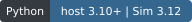](docs/LINUX-SETUP.md#which-environment-does-what)
[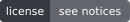](docs/VENDORING.md)

**[Quick setup](#quick-setup)** · [Example prompts](#things-you-can-ask) · [All tools](#the-tools) · [Docs](docs/README.md) ·
[Tool arguments](docs/TOOLS-ARGUMENTS.md) · [For agents](AGENTS.md)

[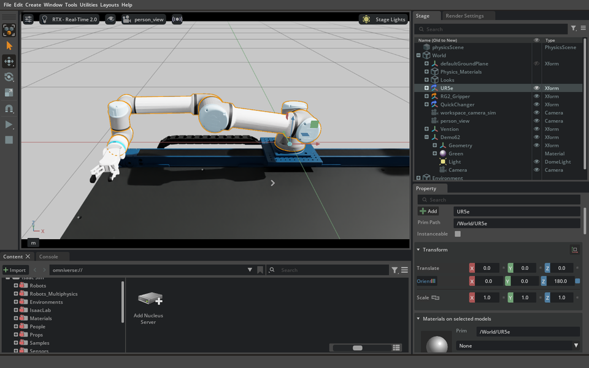](docs/media/README.md)

<sub>A UR5e driven to a target and back by an agent through this server. Isaac Sim 6.2.0.0, windowed PhysX.
[Provenance and limits](docs/media/README.md).</sub>

## Things you can ask

You don't name tools. Describe the goal and the agent picks them. Each example shows a prompt and what came out. The
pictures are real captures from this server, not mock-ups. **How each one was made, which model, and the exact prompt where
an agent was given one** are in [the prompts and models record](docs/evidence/readme-examples-prompts-and-models.md).
In short: the first four pictures were built with scripted tool calls (the prompt is an example of what you could say), the
GitHub humanoid came from a tester agent running Gemini 3.8 Flash, and the walking run was driven directly by Claude Sonnet 5.5.

### Drop in a public robot by name

> Add NVIDIA's Franka Panda arm to the scene with a few colored blocks, and take a picture of it.

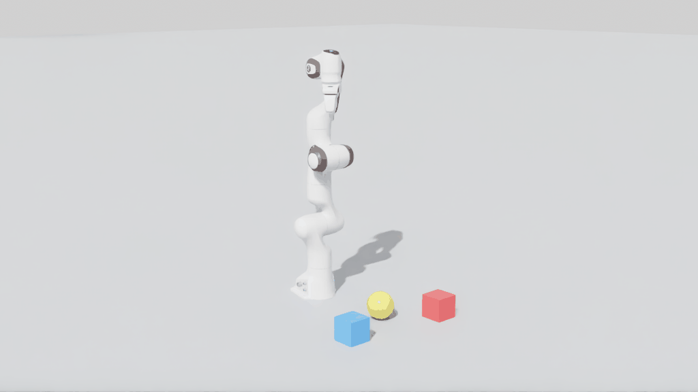

`sim__quick_start` loads the robot from NVIDIA's public asset server when you give it a name: `franka`, `ur5e`,
`nova_carter`, `carter_v1`, `create3`, `turtlebot3_burger` or `jetbot`. Nothing to download first.

### Build something from scratch and test it

> Build a tower of 36 small blocks like a Jenga tower, give each block a mass of 15 grams, let it run for ten seconds and
> tell me if it is still standing.

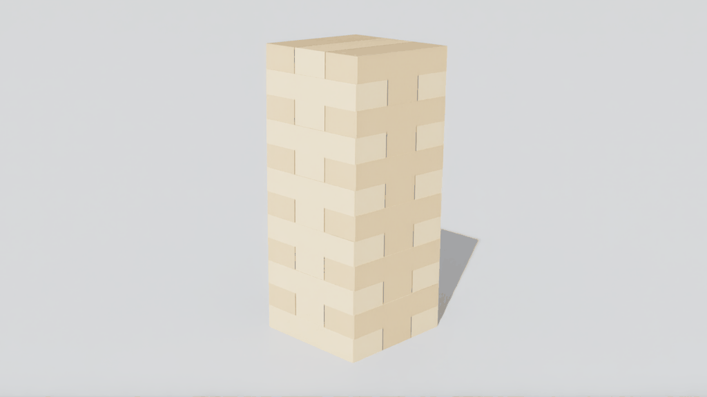

The agent made 36 box shapes, gave them mass and a material, pressed play and checked their positions. It stood.

### Put a wheeled robot in a room

> Put a Nova Carter in a room with some walls and boxes, give it a LiDAR, and tell me how far it can see.

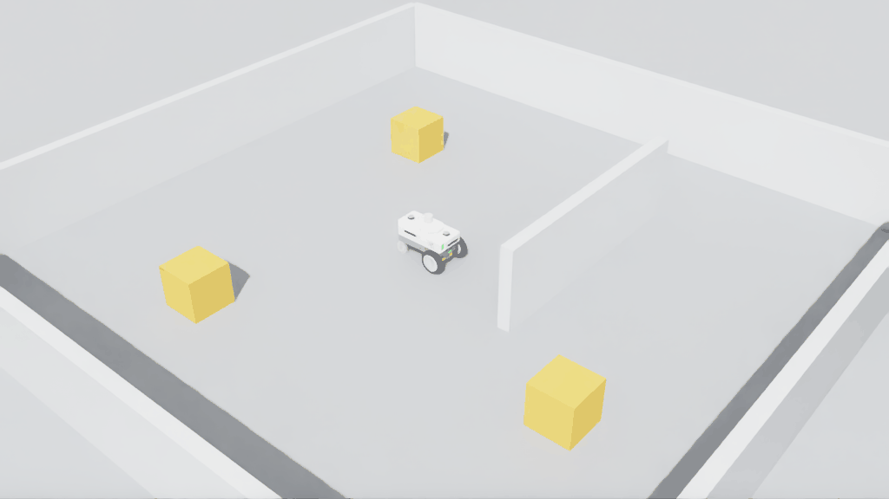

Add ROS 2 and the same scene runs Nav2: `Set up ROS 2 TF, build an occupancy map, and send the robot to a goal.`

### A warehouse with a robot in it

> Set up a warehouse with a robot in it, and drive the robot down the aisle.

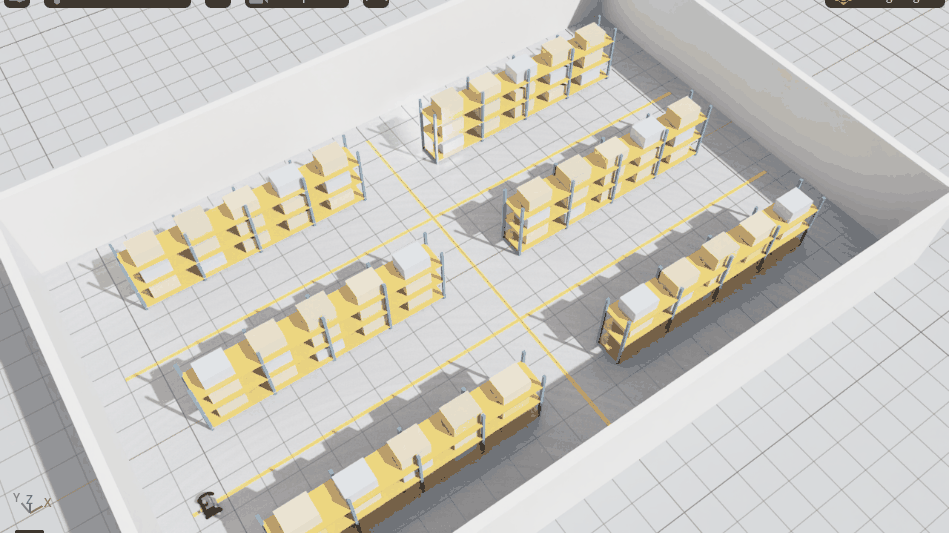

`sim__quick_start environment=warehouse` builds the room, the racks and the robot in one call, with nothing to download.
For a real floor plan, a ROS Nav2 map becomes walls: see [importing any asset](docs/ASSET-IMPORT.md#ros-maps).

**A Jenga tower you can really knock over.** `sim__quick_start environment=jenga` builds 54 dynamic blocks and a Franka with a push rod; `sim__arm__ik move=true` moves the arm in one call. In live runs on Sim 6.2 and 5.1 it pushed a block 12 cm out and the top of the tower moved 0.3 mm. See [A Jenga tower in one call](docs/TOOLS-SCENE.md#a-jenga-tower-in-one-call).

**Train a policy.** `isaaclab__train`, `eval` and `play` run on Isaac Lab, including tasks provided by a separate project: [your own task](docs/TOOLS-ISAACLAB.md#6-your-own-task). **BrickSim**, a contact-rich assembly simulator, runs next to these tools with no change to it: [BrickSim](docs/BRICKSIM.md).

### Import almost any robot or object file

> Load the UR10e from the Universal Robots repo I downloaded and bend two joints. Then drop the glTF duck next to it so it falls.

One tool, `assets__import_path`, reads **USD, URDF, xacro, SDF (Gazebo), MuJoCo XML, meshes (glTF, GLB, OBJ, STL, FBX, PLY), ROS maps and robot folders**.
The file is read and converted by the host without running any code from it (xacro and SDF included), and the result lists the
joints, limits, warnings and a validation check. Real robots from GitHub (UR10e, Franka FR3, TurtleBot3, Pioneer 2DX, SO-101,
four Menagerie robots) and props (Duck, DamagedHelmet) were imported this way in tests. Setup, formats, error codes and limits:
[docs/ASSET-IMPORT.md](docs/ASSET-IMPORT.md).

### Load your own robot from an open-source repo

> I put the SO-ARM100 robot folder in my asset folder. Load it into a new scene.

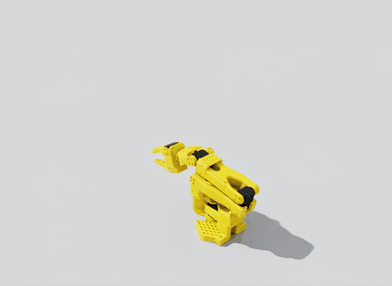

This is the open-source [SO-ARM100](https://github.com/TheRobotStudio/SO-ARM100) arm (Apache-2.0) as a URDF file. See
[your own assets](#your-assets-or-online-ones) for how that works.

### Pull a real humanoid from GitHub

> I'm starting a robotics project. Pick a well-known open-source robot from GitHub, clone it, get it into a simulated scene, make it move, and show me a picture. Then put some objects around it, add a camera and a LiDAR, and see what happens when something hits it.

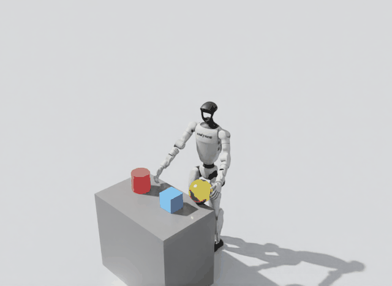

A small, fast model (Gemini 3.8 Flash), given a request like that one (the [exact prompt](docs/evidence/readme-examples-prompts-and-models.md#brief-1-robot-from-github-gemini-38-flash-thinking-level-high) is longer and adds sandbox rules), chose Unitree's G1, cloned `unitreerobotics/unitree_ros`, and found the repo too
big to import in one go (1,597 files). It built a pack with `assets__pack_build` (the one URDF and its 36 meshes, 19 MB),
loaded it by name, posed the arms and waist, built the table and objects, added a camera and a LiDAR (118,000 points), and
dropped a 2 kg ball on it. It then did the same for Google's Barkour quadruped from MuJoCo Menagerie. The G1 was loaded with
a fixed base, so it holds a pose; it does not balance or walk.

### Train a humanoid to walk

> Train the Unitree G1 to walk on flat ground, tell me how it did, and show it to me in a window.

There was no agent prompt for this one: Claude Sonnet 5.5 called the tools directly (the [exact calls](docs/evidence/readme-examples-prompts-and-models.md#the-humanoid-walking-run-the-exact-tool-calls) are recorded), so the prompt above is an example. It used Isaac Lab's built-in G1 task, `Isaac-Velocity-Flat-G1-v0`, with NVIDIA's own G1 model (not the GitHub one above), trained twice with `isaaclab__train` (1,024 environments, rsl_rl), scored with `isaaclab__eval`, and watched in a window with `isaaclab__play`. The arrows over the robots are the speed commands each one follows.

| Short run: 300 iterations | Longer run: 1,500 iterations |
|---|---|
| 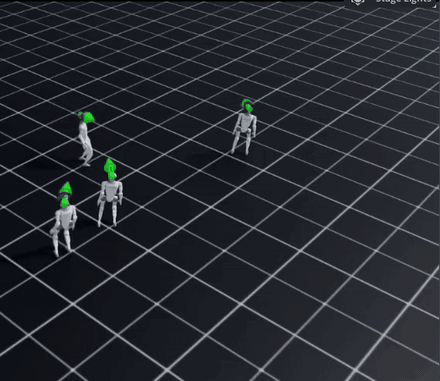 | 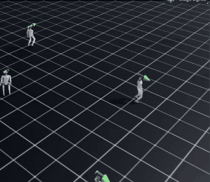 |

| | 300 iterations | 1,500 iterations |
|---|---|---|
| Training time | 152 s | 727 s |
| Speed-tracking reward at the end (higher is better) | 0.37 | 0.91 |
| Training episodes ended by a fall | 39% | 1.4% |
| Evaluation: 16 episodes, all lasted the full 1,000 steps | mean return 13.3 (spread 4.5) | mean return 34.4 (spread 0.9) |

So 12 more minutes of training took it from "stays up and mostly follows the command" to a much steadier and more accurate
walk. These are one run each (different seeds: 1 and 2), not a measured average, and the pictures are a flat grid, not a
rough-terrain test. Training your own robot requires a task supplied by your project; the
[checklist](docs/CHECKLIST.md#robotics-and-learning) tracks further robotics work. The full
40-second window recordings are kept with the project's draft evidence release, not in git.

### More prompts

**Look and measure**
> Take a screenshot of the Isaac Sim window and tell me what you see. Then record ten seconds of it.

> How tall is the tower, and which block is furthest from the middle?

**Move a robot**
> Raise the arm to a pose I describe, read back the joint angles, and tell me how far each joint is from its target.

**Train and evaluate (Isaac Lab)**
> Train the cartpole task for a few hundred iterations, watch the reward, then evaluate the latest checkpoint and give me the score.

> Compare rsl_rl with rl_games on the Reach task and report which learned faster in the same time.

Pictures: Isaac Sim 6.2.0.0, PhysX, headless camera captures. Details in [media notes](docs/media/README.md).

## Your assets, or online ones

The repository ships no robots or props, so anything you load comes from one of three places.

| Source | How you use it | Good for |
|---|---|---|
| **A public name** | Say `franka`, `nova_carter`, `ur5e`... in the prompt. It loads from NVIDIA's asset server. | Trying things quickly. |
| **Your asset folder** | Put a project folder in `isaac-mcp-assets/` (next to the checkout) and load it by name, such as `so_arm100/so100.urdf`. | Your own robots, props and scenes, and open-source ones you download. |
| **Any other folder** | You approve the folder once as a trusted root, then the agent can import from it. | A project that has to stay where it is. |

**Your asset folder** is one folder on your machine, `isaac-mcp-assets` by default, with a subfolder per project. Each
subfolder is called a **pack**. To add one:

1. Copy the project into it, for example `isaac-mcp-assets/so_arm100/` holding `so100.urdf` and its meshes.
2. Ask your agent: *"List my asset packs, then pin the so_arm100 folder."* A folder only becomes a pack once it is
   pinned, which records a checksum of every file so a changed file is noticed.
3. Ask for it by name: *"Make a scene with the so_arm100/so100.urdf robot."*

The agent uses `assets__packs`, `assets__pack_pin` and `sim__quick_start`. From a terminal, the same is
`python3 scripts/isaac_assets.py adopt <folder>`. To keep the folder somewhere else, set `ISAAC_MCP_ASSET_PATH` before
starting Isaac Sim and restart it.

**Good to know**
- **Your files win.** If your folder has a file with the same name as an online one, yours is used, and nothing is
  silently replaced.
- **Online loading is optional.** Set `ISAAC_MCP_ASSET_STRICT=1` and nothing is fetched from NVIDIA; a missing file is an
  error. Each result says where every file came from.
- **Trust.** Loading USD and URDF runs native parsers that are not sandboxed, so only load files you trust. Approving
  other folders is deliberately something only you can do, not the agent.
- **Packs of USD scenes** work the same way. `assets__pack_build` copies a USD and only the files it needs into a pack.

Full details, including the UR5e twin's files: [Assets](docs/ASSETS.md).

## The tools

A client lists **134 tools** by default, or **143** with both optional groups. Most scene work uses the first row.

| Group | Tools | What they do |
|---|--:|---|
| Generic scene and assets | 71 | Build and inspect any USD scene: prims, transforms, lights, materials, cameras, LiDAR, joints, physics, contacts, raycasts, OmniGraph, ROS 2 TF, occupancy maps, saving. Run your own controller in the physics loop and replay a saved trajectory into a labelled video. Import USD and URDF, and manage named asset packs. |
| Isaac Lab | 18 | Find an install, list tasks, check an environment, train, evaluate, play and record, check GPU room, wait for a job and read its exit code and run folder, summarise evaluation pass counts, register baseline checkpoints, read metrics and checkpoints, cancel jobs. `run_script` runs any Python script as a managed job. No simulator needed. |
| Host gateway and desktop | 13 | `isaac_help`, `refresh_tools`, `use_bridge`, and screenshots, recordings and window tools. |
| Bridge built-ins | 9 | `status` (where am I, in one call), `run_python`, `job_status` and `job_cancel` for long simulator work, and file transfer into and out of the running simulator. |
| UR5e digital twin | 23 | The RISE lab's UR5e twin, Kaleb's work with that robot. Only needed for that twin. |
| Optional: desktop input, managed sessions | 9 | `window_*` desktop input and `sim__launch` managed simulator sessions, when you switch them on. |

The ones you will meet first:

| Tool | Use it to |
|---|---|
| `sim__quick_start` | Build a ready scene (ground, physics, light, camera), optionally with a public robot. Start here. |
| `sim__stage__info` | See what the current scene is and get the IDs the other tools need. |
| `sim__prim__create` / `sim__prim__find` | Add shapes and robots, or search the scene. |
| `sim__joints__state` / `sim__joints__command` | Read joints and drive them. |
| `sim__simulation__step`, `sim__timeline__control` | Play, pause and step the physics; `action=reset` gets back to a clean stop. |
| `sim__simulation__run`, `sim__trajectory__replay` | Fly or drive a body with your own controller every physics step, then replay the logged trajectory into a labelled video. Both return a `job_id` for `job_status`. |
| `sim__camera__capture`, `sim__lidar__read` | See through a camera or LiDAR. |
| `sim__ros2__tf_setup`, `sim__map__occupancy` | Publish `/clock`, `/joint_states`, TF, and export a Nav2 map. |
| `assets__import_path`, `assets__pack_build` | Bring in your own robots and props from one tool: USD, URDF, xacro, SDF, MuJoCo XML, meshes, ROS maps, or a folder that holds one. See [docs/ASSET-IMPORT.md](docs/ASSET-IMPORT.md). |
| `screenshot`, `start_screen_recording` | Look at the real Isaac Sim window. |
| `isaaclab__train`, `isaaclab__eval`, `isaaclab__metrics_summary` | Train a policy, score it, read the curves. |

Every tool and argument is listed in [TOOLS-ARGUMENTS.md](docs/TOOLS-ARGUMENTS.md), generated from the code.
How each group behaves: [scene and assets](docs/TOOLS-SCENE.md) · [Isaac Lab](docs/TOOLS-ISAACLAB.md) ·
[host and desktop](docs/TOOLS-HOST.md) · [UR5e twin](docs/TOOLS-UR5E.md).

## Quick setup

You need Linux (Ubuntu 24.04 or 22.04), [uv](https://docs.astral.sh/uv/getting-started/installation/) and an NVIDIA GPU.

**1. Install the server.** Already have Isaac Sim 6.x? Use it. This never downloads a simulator:

```bash
git clone https://github.com/kalebcoleman/isaac-mcp.git
cd isaac-mcp
python3 scripts/isaac_env.py find     # should list your Isaac Sim
./install.sh --no-sim --claude-code   # drop --claude-code to skip client registration
export PATH="$HOME/.local/bin:$PATH"
```

If `find` shows nothing, set `ISAACSIM_PATH=/path/to/isaac-sim` and run it again.

<details>
<summary><b>No Isaac Sim yet? Install the pinned 6.2 environment (about 20 GB)</b></summary>

Read the [prerequisites](docs/LINUX-SETUP.md#new-pinned-62-installation) first. It needs 40 GB free, and `--accept-eula`
accepts NVIDIA's EULA.

```bash
./install.sh --accept-eula --download-sim --claude-code
export PATH="$HOME/.local/bin:$PATH"
```
</details>

Using Codex, OpenCode or Claude Desktop? See [client configuration](docs/MCP-SERVER.md#4-client-configuration), and
reconnect your client after changing it.

**2. Start the simulator** and leave that terminal open (the first start can take minutes while shaders compile):

```bash
./run.sh --port 8766        # add --headless for no window; a GPU is still required
```

**3. Ask your agent:**

> Refresh the Isaac tools, check the simulator with status, then call sim__quick_start and tell me what it built.

That is it. From there, use any prompt above. Trouble connecting? See
[troubleshooting](docs/LINUX-SETUP.md#troubleshooting-the-first-connection), or check from a terminal with
`python3 mcp/isaac_mcp/client.py status --port 8766`.

> [!NOTE]
> **Pre-release, Linux x86_64 only.** PhysX is the release target; Newton is
> [experimental](docs/COMPATIBILITY.md#release-backend-scope). The two claimed builds are Isaac Sim **6.2.0.0 with Isaac Lab 3.0.0** (the installer's pin)
> and Isaac Sim **5.1.0.0 with Isaac Lab 2.3.2**. 6.0.0.0, 6.0.0.1, 6.0.1.0 and 6.1.0.0 are best effort; results per build are in the
> [compatibility matrix](docs/COMPATIBILITY.md). This is not an all-version certification. Isaac Lab jobs and the simulator
> share GPU memory. Two small headless sessions have run together on a 16 GB card; check workload and memory first. See
> [parallel sessions](docs/MCP-SERVER.md#3-multi-session-configuration-ports) and the separate Lab job guards.

> [!WARNING]
> `run_python`, the file tools and trusted asset loading run with your account's permissions and are not sandboxed.
> Keep the bridge on loopback and approve only project folders you trust. See the
> [trust limits](docs/TOOLS-HOST.md#trust-and-operational-limits).

## Make your agent actually use it

Agents often skip MCP tools and write their own scripts, screenshots and logging, even when the server is installed.
Two things fix that:

1. **Put the rule where every project inherits it.** `python3 scripts/isaac_env.py init` now writes `AGENTS.md` and
   `CLAUDE.md` into your workspace folder (existing files are never overwritten). They tell the agent to load the
   `mcp__isaac` tools, check `status`, and try the server before writing its own code. For an existing workspace, run
   `init` again; it only adds the missing files. For a standalone repo, copy the block from
   [docs/WORKSPACE.md](docs/WORKSPACE.md#agent-rules-for-every-project) into the repo's `AGENTS.md`.
2. **Ask by name in the first prompt.** For example: "Use the isaac MCP for screenshots, recordings and contact checks.
   If you can't, say why before you write a script."

Headless runs are fine: `sim__camera__capture` takes pictures without a window.

## How it fits together

Three programs are involved, and it helps to know which does what.

1. **Your AI agent** (Claude Code, Codex, OpenCode). It talks to this project using MCP, a standard way for an agent to
   call tools. It never touches Isaac Sim directly.
2. **The isaac-mcp server**, a small ordinary Python program your agent starts. It lists the tools and passes each call
   on to the right place. It does not need Isaac Sim installed, which is why the tool list appears instantly, even when
   no simulator is running.
3. **Isaac Sim**, which does the real work. Isaac Sim is built on NVIDIA's *Kit*, an application framework, so a running
   Isaac Sim is often called "a Kit process". `./run.sh` starts one with this project's extensions loaded.

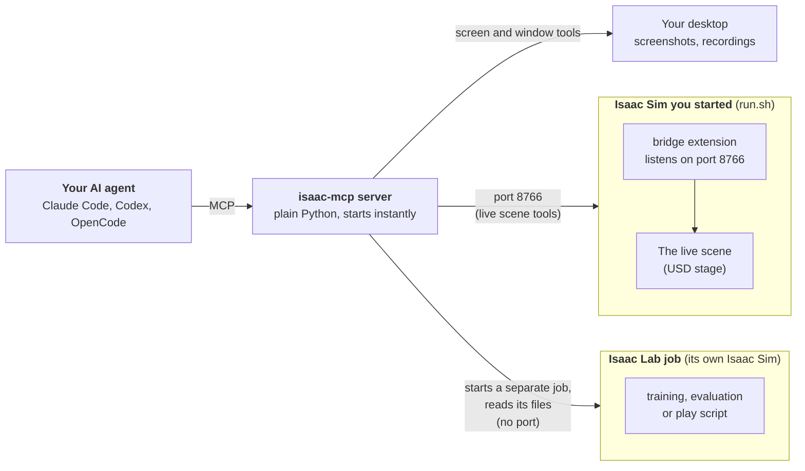

**Why the scene tools use port 8766.** A scene (a USD *stage*, the 3D world Isaac Sim holds in memory) can only be
changed from inside the Isaac Sim process that holds it. So Isaac Sim loads a small *bridge* extension that listens on a
local network port, 8766 by default. When you ask for a cube, the server sends "create a cube here" to the bridge, the
bridge makes it inside the running scene, and the answer comes back. That is every `sim__*`, `assets__*`, `ur5e_dt__*`
and built-in tool such as `run_python`.

**Why Isaac Lab does not.** Isaac Lab is a robot-learning framework built on top of Isaac Sim. A Lab training run is a
separate program: it starts *its own* Isaac Sim, builds many copies of a task, trains for minutes or hours, then exits.
There is no scene of yours to reach into, so there is nothing for a bridge to do. The server starts the job, then watches
its log, metrics, checkpoints and exit code (`isaaclab__runs_status`, `isaaclab__metrics_summary`). Because a Lab job and
your interactive Isaac Sim are each a full simulator, they compete for the GPU. On a 16 GB card, a Lab job refuses to start
while your bridge is running unless you pass `allow_concurrent_gpu=true`.

**The desktop tools** take screenshots and recordings of windows on your screen, so they need neither.

A call that needs the bridge when no simulator is running returns an error that says what to do, `status` says in one
call what is running, and `refresh_tools` finds a simulator you have started.

The whole system on one page, with the tool groups, the files and the data flows:

[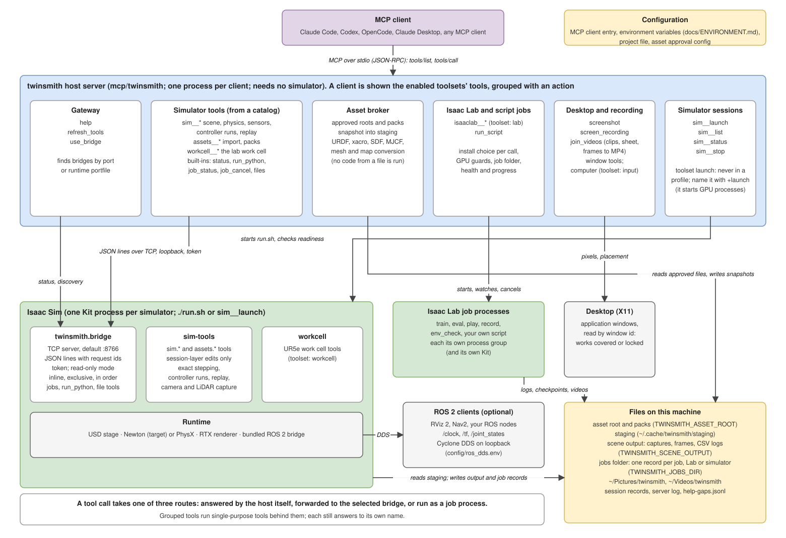](docs/ARCHITECTURE.md)

[How isaac-mcp works](docs/ARCHITECTURE.md) explains each part. The diagram is editable:
[`docs/architecture.drawio`](docs/architecture.drawio).

### Words used in these docs

| Term | Meaning |
|---|---|
| **MCP** | Model Context Protocol: the standard way an AI agent calls tools. |
| **Host server** | The isaac-mcp program your agent starts. Plain Python, no Isaac Sim needed. |
| **Kit** | NVIDIA's application framework. Isaac Sim is a Kit app, so "a Kit process" means a running Isaac Sim. |
| **Bridge** | The extension inside Isaac Sim that listens on port 8766 and runs the host's requests on the live scene. |
| **USD stage** | The 3D scene Isaac Sim holds, made of "prims" (objects, lights, cameras, robots). |
| **Prim** | One item in the scene, found by a path such as `/World/Cube`. |
| **Articulation / joints** | A robot's linked parts and the motors between them. |
| **Isaac Lab** | NVIDIA's robot-learning framework built on Isaac Sim. Each job runs its own Isaac Sim. |
| **Headless** | Running with no window. A GPU is still needed. |
| **ROS 2, Nav2, RViz** | A robotics software stack, its navigation package and its viewer, for the ROS tools. |

## Where to go next

| I want to... | Read |
|---|---|
| Find an argument or default | [Tool arguments](docs/TOOLS-ARGUMENTS.md) |
| Import my own USD or URDF | [Assets and packs](docs/ASSETS.md) · [Project roots](docs/TOOLS-SCENE.md#one-time-approval) |
| Use ROS 2, RViz 2 or Nav2 | [ROS 2 and RViz 2](docs/ROS2-RVIZ.md) |
| Run the UR5e lab twin | [UR5e twin](docs/TOOLS-UR5E.md) · [lab files](docs/ASSETS.md#public-files-and-lab-files) |
| Configure the server | [Client configuration](docs/MCP-SERVER.md#4-client-configuration) · [Environment variables](docs/ENVIRONMENT.md) |
| Check results or report a problem | [Verification](docs/VERIFICATION.md) · [Reproducibility](docs/REPRODUCIBILITY.md) |
| Add my own tools | [Tool authoring](mcp/docs/tool-authoring.md) |
| See everything | [Documentation index](docs/README.md) |

## Check a machine

After installing, on any machine (this PC, a home PC, a lab PC):

```bash
"$(uv tool dir)/isaac-mcp/bin/python" scripts/smoke_test.py            # add --no-lab if Isaac Lab is not installed
```

It checks that the server lists `isaac_help` and the Isaac Lab tools, that `isaaclab__preflight` answers, and, when
Isaac Lab is found (`ISAACLAB_PYTHON` and `ISAACLAB_ROOT`, or automatically), runs a real `isaaclab__env_check` and
`isaaclab__record` on `Isaac-Cartpole`. It prints PASS, FAIL or SKIP per item and exits 1 on any FAIL.
Install with `./install.sh --no-sim --claude-code` so the `[isaaclab]` extra (TensorBoard, for the metrics tools) is included.

## Development

The host lives in `mcp/`, the Kit extensions in `exts/`, and setup and validation helpers in `scripts/`.
Before pushing, run the same CPU-only checks as CI:

```bash
python3 scripts/check_docs.py
python3 scripts/check_assets.py
python3 scripts/check_portable_paths.py
python3 scripts/gen_host_catalog.py --check
cd mcp && uv run --locked --isolated --python 3.12 --extra test --extra isaaclab --extra scene-test pytest -q
```

CI covers the host only; it does not establish GPU or simulator behavior. Live checks are in
[Verification](docs/VERIFICATION.md). Do not run `uv sync` or `uv run` in the repository root unless you
want the 20 GB simulator environment. See [AGENTS.md](AGENTS.md) for agent rules.

## Credits and license

MIT licensed. Built on Aldrin Inbaraj's [omni-kit-mcp](https://github.com/inbarajaldrin/omni-kit-mcp) and
[isaac-sim-mcp](https://github.com/inbarajaldrin/isaac-sim-mcp). The latter carries an MIT license;
the former has no upstream license file. Component and asset terms differ, so read
[VENDORING](docs/VENDORING.md) and the [asset notices](docs/provenance/ASSETS.md) before redistributing.
NVIDIA's installed runtime packages remain subject to their own terms.
