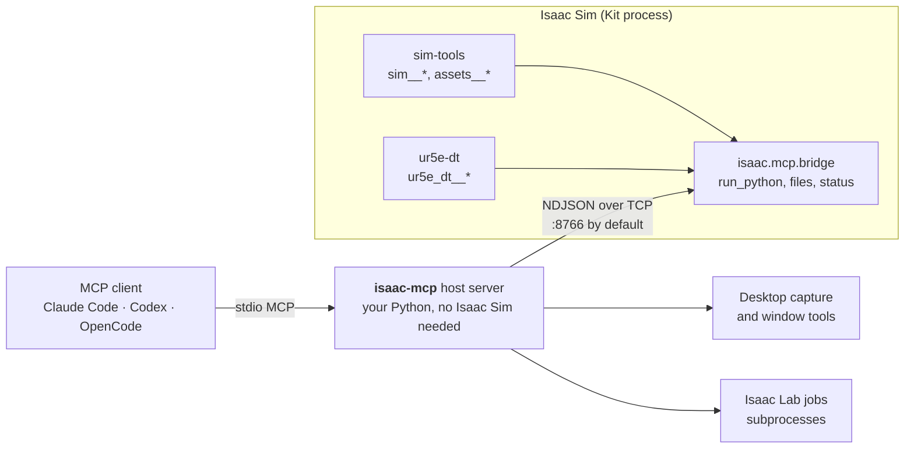

# isaac-mcp

**Give your AI agent eyes and hands inside NVIDIA Isaac Sim.** One [Model Context Protocol](https://modelcontextprotocol.io)
server to inspect and build USD scenes, drive robots and physics, capture sensors, and run Isaac Lab
jobs, from Claude Code, Codex, OpenCode or any other MCP client.

[](https://github.com/kalebcoleman/isaac-mcp/actions/workflows/ci.yml)
[](mcp/pyproject.toml)
[](docs/COMPATIBILITY.md)
[](docs/LINUX-SETUP.md#which-environment-does-what)
[](docs/VENDORING.md)

**[Quick start](#quick-start)** · [All docs](docs/README.md) · [Tool arguments](docs/TOOLS-ARGUMENTS.md) ·
[Setup guide](docs/LINUX-SETUP.md) · [Compatibility](docs/COMPATIBILITY.md) · [For agents](AGENTS.md)

[](docs/media/README.md)

<sub>Original application capture of an MCP-driven target-and-return run: Isaac Sim 6.2.0.0, windowed PhysX.
[Return view, provenance and limits](docs/media/README.md).</sub>

## What you can do

| | |
|---|---|
| **Work with your own scenes** | Inspect USD hierarchies, author prims, lights and materials, import trusted USD and URDF projects, build OmniGraph graphs, step physics and save composed scenes. |
| **See the result** | Capture fresh camera frames and LiDAR points, screenshot or record the real application window, and drive Isaac Sim's own UI, even on a locked or remote desktop. |
| **Connect ROS 2** | Set up `/clock`, `/joint_states` and TF in one call, write an RViz 2 config, diagnose the live TF tree and export a Nav2 occupancy map. |
| **Operate a UR5e digital twin** | Build the workstation, use simulated ROS streams, and exercise motion with measured feedback. |
| **Run Isaac Lab jobs** | Discover an existing Lab install, launch training, evaluation or play, and read metrics and checkpoints. |

## How it fits together



The host starts instantly and lists its tools before Isaac Sim is running. Anything that touches a
scene needs a live bridge, and a call without one returns an error that says what to do. See
[Architecture](docs/ARCHITECTURE.md).

| Tools | Count | Examples | Needs |
|---|--:|---|---|
| Generic scene and assets | 48 | `sim__stage__info`, `sim__graph__build`, `assets__import_path` | Kit with `sim-tools` (three asset tools run on the host) |
| UR5e digital twin | 23 | `ur5e_dt__quick_start_with_workstation` | Kit with `ur5e-dt` and [its assets](docs/ASSETS.md) |
| Isaac Lab | 12 | `isaaclab__train`, `isaaclab__metrics_summary` | An Isaac Lab install for job tools |
| Host gateway and desktop | 12 | `refresh_tools`, `screenshot`, `tile_windows` | A display for the desktop tools |
| Bridge built-ins | 7 | `status`, `run_python`, `put_file` | Any Kit with the bridge |
| Optional: desktop input, managed sessions | 9 | `window_click`, `sim__launch` | Explicit opt-in |

A client lists **102 tools** by default, or **111** with both optional groups.
[Filters and tiers](AGENTS.md#what-you-can-reach-by-tier) explain any other number.

> [!NOTE]
> **Status: pre-release, Linux x86_64 only.** PhysX is the release target; Newton is
> [experimental](docs/COMPATIBILITY.md#release-backend-scope). The installer pins Isaac Sim **6.2.0.0**, with scoped results
> for 6.0.0.0, 6.0.0.1, 6.0.1.0 and 6.1.0.0. These are recorded per source and mode in the
> [compatibility matrix](docs/COMPATIBILITY.md), which also lists open issues, including an
> [unexplained 6.0.1 windowed stall](docs/evidence/project-scene/PHYSX-STALL-DISPOSITION.md). This is not an
> all-version or clean-machine certification.

## Quick start

You need Ubuntu 24.04 or 22.04, [uv](https://docs.astral.sh/uv/getting-started/installation/), and an NVIDIA GPU.

### 1. Install

**Already have Isaac Sim 6.x?** Use it. The installer finds it, installs only the MCP server and records that
interpreter in the Claude entry, so `sim__launch` uses it too:

```bash
git clone https://github.com/kalebcoleman/isaac-mcp.git
cd isaac-mcp
python3 scripts/isaac_env.py find     # check this lists your Isaac Sim first
./install.sh --claude-code            # omit --claude-code to skip client registration
```

If `find` shows nothing, export `ISAAC_MCP_PYTHON=/path/to/python` or `ISAACSIM_PATH=/path/to/isaac-sim` and run it again.

> [!IMPORTANT]
> If no Isaac Sim is found, `./install.sh` stops at the EULA check. But if `OMNI_KIT_ACCEPT_EULA=YES` is already exported, it goes on
> to download about 20 GB. `./install.sh --no-sim` never downloads, but records no interpreter: put `ISAAC_MCP_PYTHON` in the
> client's `isaac` entry yourself, and in the shell that starts `run.sh` if it is not auto-detected.
> See [existing installs and older builds](docs/LINUX-SETUP.md#choose-a-simulator-build).

<details>
<summary><b>No Isaac Sim yet? Install the pinned 6.2 environment (about 20 GB)</b></summary>

Read the [prerequisites and installation effects](docs/LINUX-SETUP.md#new-pinned-62-installation) first. It needs at
least 40 GB free, and `--accept-eula` accepts NVIDIA's EULA.

```bash
git clone https://github.com/kalebcoleman/isaac-mcp.git
cd isaac-mcp
./install.sh --accept-eula --download-sim --claude-code
export PATH="$HOME/.local/bin:$PATH"
uv pip check --python .venv/bin/python
```

For an exact-source install, use the [locked setup](docs/REPRODUCIBILITY.md#locked-simulator-setup). Neither path
installs Isaac Lab or system ROS.
</details>

Other clients (Codex, OpenCode, Claude Desktop, Antigravity): see [client configuration](docs/MCP-SERVER.md#4-client-configuration).
Reconnect your client after changing its configuration.

### 2. Start the simulator

```bash
./run.sh --port 8766               # add --headless for no window; a GPU is still required
```

The first start can take minutes while shaders compile. Keep this terminal open.

### 3. Ask your agent

> Refresh the Isaac tools, select my intended bridge if more than one is available, and verify its
> PID, port and build with status. Call sim__stage__info and report the stage identity, units and
> readiness. Do not create, reset or play a scene yet.

No agent handy? [The same check works from a terminal](docs/LINUX-SETUP.md#connect-and-check-without-changing-the-scene):

```bash
python3 mcp/isaac_mcp/client.py --list-bridges
python3 mcp/isaac_mcp/client.py status --port 8766
```

### 4. Optional: build the UR5e demo

The repository ships **no assets**. Fetch NVIDIA's public robot and sensor files once, into a local
folder next to the checkout, then ask your agent to call `ur5e_dt__quick_start`:

```bash
python3 scripts/fetch_ur5e_assets.py          # about 26 MB; applicable asset terms apply
python3 scripts/fetch_ur5e_assets.py --check
```

The Vention bench is private and supplied separately; a placeholder is used when it is absent. Bring your
own assets with `python3 scripts/isaac_assets.py`. See [Assets](docs/ASSETS.md).

## Where to go next

| I want to... | Read |
|---|---|
| Find an argument, default or tool | [Tool arguments](docs/TOOLS-ARGUMENTS.md) (generated from the code) |
| Learn how each tool behaves | [Scene and assets](docs/TOOLS-SCENE.md) · [Host and desktop](docs/TOOLS-HOST.md) · [UR5e](docs/TOOLS-UR5E.md) · [Isaac Lab](docs/TOOLS-ISAACLAB.md) |
| Import my own USD or URDF project | [Trusted project roots](docs/TOOLS-SCENE.md#one-time-approval) · [Assets](docs/ASSETS.md) |
| Use ROS 2, RViz 2 or Nav2 | [ROS 2 TF and RViz 2](docs/ROS2-RVIZ.md) · [Isaac Sim 6.2 notes](docs/ISAAC-6.2-NOTES.md) |
| Configure the server | [Client configuration](docs/MCP-SERVER.md#4-client-configuration) · [Environment variables](docs/ENVIRONMENT.md) |
| Fix a failed first connection | [Troubleshooting](docs/LINUX-SETUP.md#troubleshooting-the-first-connection) |
| Check results or report an issue | [Verification](docs/VERIFICATION.md) · [Reproducibility](docs/REPRODUCIBILITY.md) |
| Add my own tools | [Tool authoring](mcp/docs/tool-authoring.md) · [Host package guide](mcp/README.md) |
| See everything | [Documentation index](docs/README.md) |

> [!WARNING]
> `run_python`, the file tools and trusted asset loading run with your account's permissions and are not
> sandboxed. Keep the bridge on loopback, and approve only project folders you trust. Read the
> [trust and operational limits](docs/TOOLS-HOST.md#trust-and-operational-limits).

## Development

The host lives in `mcp/`, the Kit extensions in `exts/`, and setup and validation helpers in `scripts/`.
Before pushing, run the same CPU-only checks as CI:

```bash
python3 scripts/check_docs.py
python3 scripts/check_assets.py
python3 scripts/check_portable_paths.py
python3 scripts/gen_host_catalog.py --check
cd mcp && uv run --isolated --python 3.12 --with-editable . --extra test --extra isaaclab --extra scene-test pytest -q
```

CI covers the host only; it does not establish GPU or simulator behavior. Live checks are in
[Verification](docs/VERIFICATION.md). Do not run `uv sync` or `uv run` in the repository root unless you
want the 20 GB simulator environment. See [AGENTS.md](AGENTS.md) for agent rules.

## Credits and license

MIT licensed. Built on Aldrin Inbaraj's [omni-kit-mcp](https://github.com/inbarajaldrin/omni-kit-mcp) and
[isaac-sim-mcp](https://github.com/inbarajaldrin/isaac-sim-mcp). The latter carries an MIT license;
the former has no upstream license file. Component and asset terms differ, so read
[VENDORING](docs/VENDORING.md) and the [asset notices](docs/provenance/ASSETS.md) before redistributing.
NVIDIA's installed runtime packages remain subject to their own terms.
