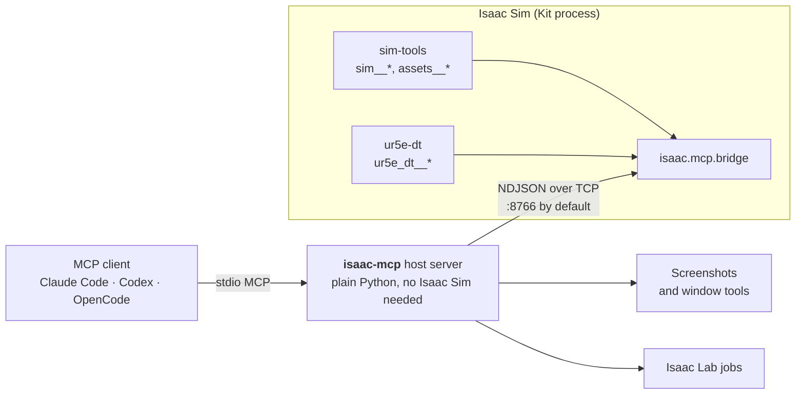

# isaac-mcp

**Talk to NVIDIA Isaac Sim.** Tell your AI agent what you want in plain English and it builds the scene, drops in
robots, runs the physics, looks through the cameras and LiDAR, and trains reinforcement-learning policies in Isaac Lab.
It works with Claude Code, Codex, OpenCode or any [MCP](https://modelcontextprotocol.io) client.

[](https://github.com/kalebcoleman/isaac-mcp/actions/workflows/ci.yml)
[](mcp/pyproject.toml)
[](docs/COMPATIBILITY.md)
[](docs/LINUX-SETUP.md#which-environment-does-what)
[](docs/VENDORING.md)

**[Quick setup](#quick-setup)** · [Example prompts](#things-you-can-ask) · [All tools](#the-tools) · [Docs](docs/README.md) ·
[Tool arguments](docs/TOOLS-ARGUMENTS.md) · [For agents](AGENTS.md)

[](docs/media/README.md)

<sub>A UR5e driven to a target and back by an agent through this server. Isaac Sim 6.2.0.0, windowed PhysX.
[Provenance and limits](docs/media/README.md).</sub>

## Things you can ask

You don't name tools. Describe the goal and the agent picks them. These are prompts that have worked.

**Build a scene**
> Make me a scene with a ground plane and a red cube dropped from one metre, then step the physics and tell me where it lands.

> Build a tower of 36 small blocks like a Jenga tower. Let it run for ten seconds and tell me whether it is still standing.

> Add NVIDIA's public UR5e robot to the scene, move its joints to a pose I describe, and take a picture from the camera.

**Sense and navigate**
> Put a wheeled robot in a room with a few walls, give it a LiDAR, and tell me how far it can see in each direction.

> Set up ROS 2 TF and a LiDAR on a Create 3, build an occupancy map, and send it to a goal with Nav2.

**Use your own files**
> Import the URDF in my asset folder, find its articulation root, and list its joints and limits.

> Turn my folder of USD props into a named asset pack, check it, and load one prop by name.

**Look at it**
> Take a screenshot of the Isaac Sim window and tell me what you see. Then record ten seconds of it.

**Train and evaluate (Isaac Lab)**
> Train the cartpole task for a few hundred iterations, watch the reward, then evaluate the latest checkpoint and give me the score.

> Compare rsl_rl with rl_games on the Reach task and report which learned faster in the same time.

## The tools

A client lists **122 tools** by default, or **131** with both optional groups. Most scene work uses the first row.

| Group | Tools | What they do |
|---|--:|---|
| Generic scene and assets | 68 | Build and inspect any USD scene: prims, transforms, lights, materials, cameras, LiDAR, joints, physics, contacts, raycasts, OmniGraph, ROS 2 TF, occupancy maps, saving. Import USD and URDF, and manage named asset packs. |
| Isaac Lab | 12 | Find an install, list tasks, train, evaluate and play, read metrics and checkpoints, cancel jobs. No simulator needed. |
| Host gateway and desktop | 12 | `refresh_tools`, `use_bridge`, and screenshots, recordings and window tools. |
| Bridge built-ins | 7 | `status`, `run_python`, and file transfer into and out of the running simulator. |
| UR5e digital twin | 23 | The RISE lab's UR5e twin, Kaleb's work with that robot. Only needed for that twin. |
| Optional: desktop input, managed sessions | 9 | `window_*` desktop input and `sim__launch` managed simulator sessions, when you switch them on. |

The ones you will meet first:

| Tool | Use it to |
|---|---|
| `sim__quick_start` | Build a ready scene (ground, physics, light, camera), optionally with a public robot. Start here. |
| `sim__stage__info` | See what the current scene is and get the IDs the other tools need. |
| `sim__prim__create` / `sim__prim__find` | Add shapes and robots, or search the scene. |
| `sim__joints__state` / `sim__joints__command` | Read joints and drive them. |
| `sim__simulation__step`, `sim__timeline__control` | Play, pause and step the physics. |
| `sim__camera__capture`, `sim__lidar__read` | See through a camera or LiDAR. |
| `sim__ros2__tf_setup`, `sim__map__occupancy` | Publish `/clock`, `/joint_states`, TF, and export a Nav2 map. |
| `assets__import_urdf`, `assets__pack_build` | Bring in your own robots and props. |
| `screenshot`, `start_screen_recording` | Look at the real Isaac Sim window. |
| `isaaclab__train`, `isaaclab__eval`, `isaaclab__metrics_summary` | Train a policy, score it, read the curves. |

Every tool and argument is listed in [TOOLS-ARGUMENTS.md](docs/TOOLS-ARGUMENTS.md), generated from the code.
How each group behaves: [scene and assets](docs/TOOLS-SCENE.md) · [Isaac Lab](docs/TOOLS-ISAACLAB.md) ·
[host and desktop](docs/TOOLS-HOST.md) · [UR5e twin](docs/TOOLS-UR5E.md).

## Quick setup

You need Linux (Ubuntu 24.04 or 22.04), [uv](https://docs.astral.sh/uv/getting-started/installation/) and an NVIDIA GPU.

**1. Install the server.** Already have Isaac Sim 6.x? Use it. This never downloads a simulator:

```bash
git clone https://github.com/kalebcoleman/isaac-mcp.git
cd isaac-mcp
python3 scripts/isaac_env.py find     # should list your Isaac Sim
./install.sh --no-sim --claude-code   # drop --claude-code to skip client registration
export PATH="$HOME/.local/bin:$PATH"
```

If `find` shows nothing, set `ISAACSIM_PATH=/path/to/isaac-sim` and run it again.

<details>
<summary><b>No Isaac Sim yet? Install the pinned 6.2 environment (about 20 GB)</b></summary>

Read the [prerequisites](docs/LINUX-SETUP.md#new-pinned-62-installation) first. It needs 40 GB free, and `--accept-eula`
accepts NVIDIA's EULA.

```bash
./install.sh --accept-eula --download-sim --claude-code
export PATH="$HOME/.local/bin:$PATH"
```
</details>

Using Codex, OpenCode or Claude Desktop? See [client configuration](docs/MCP-SERVER.md#4-client-configuration), and
reconnect your client after changing it.

**2. Start the simulator** and leave that terminal open (the first start can take minutes while shaders compile):

```bash
./run.sh --port 8766        # add --headless for no window; a GPU is still required
```

**3. Ask your agent:**

> Refresh the Isaac tools, check the simulator with status, then call sim__quick_start and tell me what it built.

That is it. From there, use any prompt above. Trouble connecting? See
[troubleshooting](docs/LINUX-SETUP.md#troubleshooting-the-first-connection), or check from a terminal with
`python3 mcp/isaac_mcp/client.py status --port 8766`.

> [!NOTE]
> **Pre-release, Linux x86_64 only.** PhysX is the release target; Newton is
> [experimental](docs/COMPATIBILITY.md#release-backend-scope). The installer pins Isaac Sim **6.2.0.0**, and results exist for
> 6.0.0.0, 6.0.0.1, 6.0.1.0, 6.1.0.0 and Sim 5.1 with Isaac Lab 2.3.2, recorded per build in the
> [compatibility matrix](docs/COMPATIBILITY.md). This is not an all-version certification. Isaac Lab jobs and the simulator
> share one GPU, so run one at a time on a 16 GB card.

> [!WARNING]
> `run_python`, the file tools and trusted asset loading run with your account's permissions and are not sandboxed.
> Keep the bridge on loopback and approve only project folders you trust. See the
> [trust limits](docs/TOOLS-HOST.md#trust-and-operational-limits).

## How it fits together



The host starts instantly and lists its tools before Isaac Sim is running. A call that needs a scene returns an error
that says what to do if no simulator is up. See [Architecture](docs/ARCHITECTURE.md).

## Where to go next

| I want to... | Read |
|---|---|
| Find an argument or default | [Tool arguments](docs/TOOLS-ARGUMENTS.md) |
| Import my own USD or URDF | [Assets and packs](docs/ASSETS.md) · [Project roots](docs/TOOLS-SCENE.md#one-time-approval) |
| Use ROS 2, RViz 2 or Nav2 | [ROS 2 and RViz 2](docs/ROS2-RVIZ.md) |
| Run the UR5e lab twin | [UR5e twin](docs/TOOLS-UR5E.md) · [lab files](docs/ASSETS.md#public-files-and-lab-files) |
| Configure the server | [Client configuration](docs/MCP-SERVER.md#4-client-configuration) · [Environment variables](docs/ENVIRONMENT.md) |
| Check results or report a problem | [Verification](docs/VERIFICATION.md) · [Reproducibility](docs/REPRODUCIBILITY.md) |
| Add my own tools | [Tool authoring](mcp/docs/tool-authoring.md) |
| See everything | [Documentation index](docs/README.md) |

## Development

The host lives in `mcp/`, the Kit extensions in `exts/`, and setup and validation helpers in `scripts/`.
Before pushing, run the same CPU-only checks as CI:

```bash
python3 scripts/check_docs.py
python3 scripts/check_assets.py
python3 scripts/check_portable_paths.py
python3 scripts/gen_host_catalog.py --check
cd mcp && uv run --isolated --python 3.12 --with-editable . --extra test --extra isaaclab --extra scene-test pytest -q
```

CI covers the host only; it does not establish GPU or simulator behavior. Live checks are in
[Verification](docs/VERIFICATION.md). Do not run `uv sync` or `uv run` in the repository root unless you
want the 20 GB simulator environment. See [AGENTS.md](AGENTS.md) for agent rules.

## Credits and license

MIT licensed. Built on Aldrin Inbaraj's [omni-kit-mcp](https://github.com/inbarajaldrin/omni-kit-mcp) and
[isaac-sim-mcp](https://github.com/inbarajaldrin/isaac-sim-mcp). The latter carries an MIT license;
the former has no upstream license file. Component and asset terms differ, so read
[VENDORING](docs/VENDORING.md) and the [asset notices](docs/provenance/ASSETS.md) before redistributing.
NVIDIA's installed runtime packages remain subject to their own terms.
