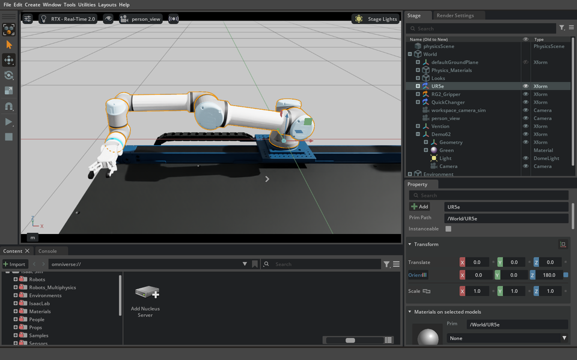
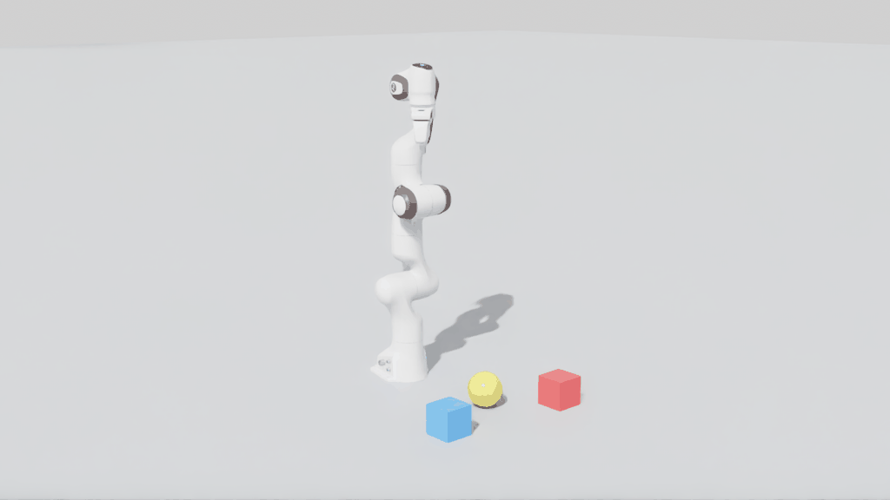
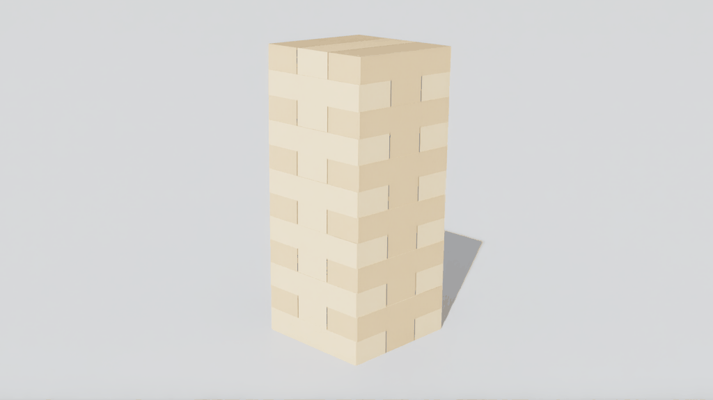
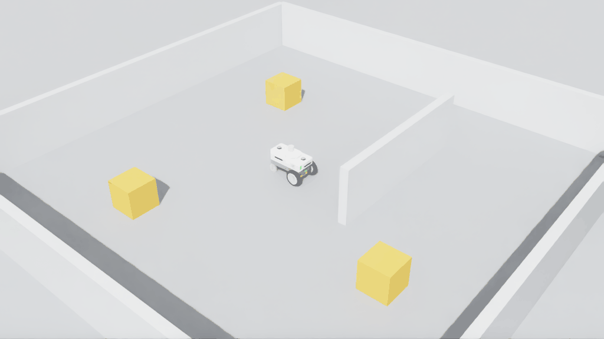
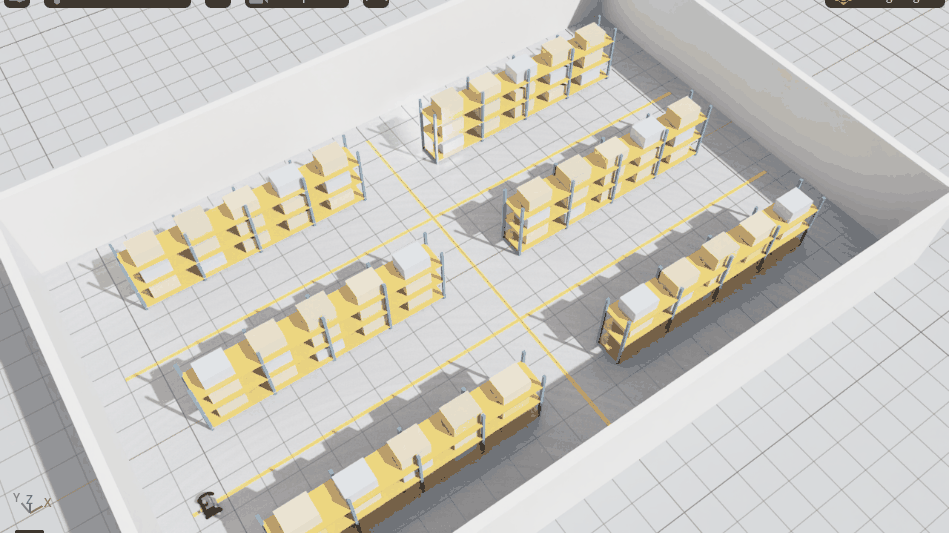
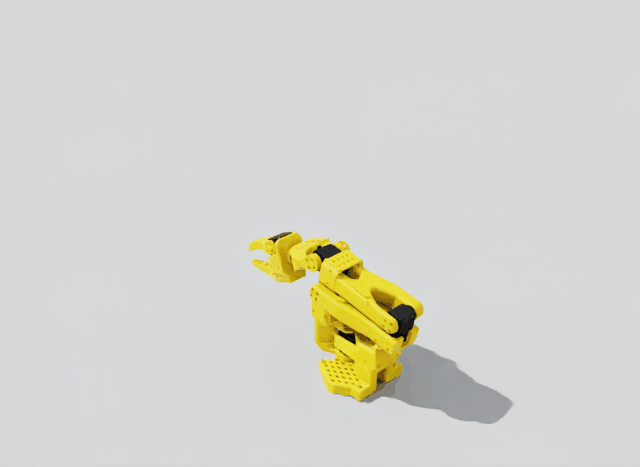
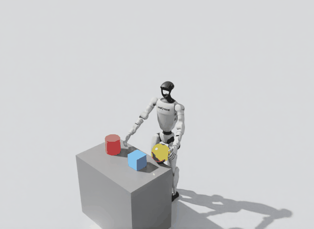
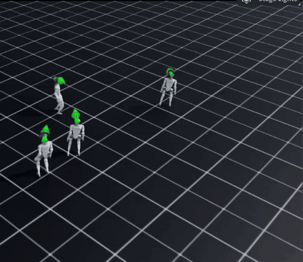
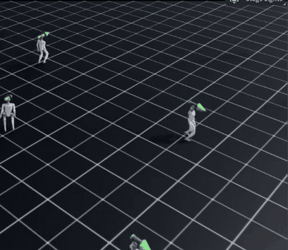

# Examples

What you can ask an agent to do with this server, with pictures from real runs. You do not name tools:
describe the goal and the agent picks them. The [README](../README.md) shows how to start; the
[toolsets](TOOLSETS.md) page says which tools are listed.

A UR5e driven to a target and back by an agent through this server. Isaac Sim 6.2.0.0, windowed PhysX.
[Provenance and limits](media/README.md).

## Things you can ask

Each example shows a prompt and what came out. The
pictures are real captures from this server, not mock-ups. **How each one was made, which model, and the exact prompt where
an agent was given one** are in [the prompts and models record](evidence/readme-examples-prompts-and-models.md).
In short: the first four pictures were built with scripted tool calls (the prompt is an example of what you could say), the
GitHub humanoid came from a tester agent running Gemini 3.8 Flash, and the walking run was driven directly by Claude Sonnet 5.5.

### Drop in a public robot by name

> Add NVIDIA's Franka Panda arm to the scene with a few colored blocks, and take a picture of it.

`sim__quick_start` loads the robot from NVIDIA's public asset server when you give it a name: `franka`, `ur5e`,
`nova_carter`, `carter_v1`, `create3`, `turtlebot3_burger` or `jetbot`. Nothing to download first.

### Build something from scratch and test it

> Build a tower of 36 small blocks like a Jenga tower, give each block a mass of 15 grams, let it run for ten seconds and
> tell me if it is still standing.

The agent made 36 box shapes, gave them mass and a material, pressed play and checked their positions. It stood.

### Put a wheeled robot in a room

> Put a Nova Carter in a room with some walls and boxes, give it a LiDAR, and tell me how far it can see.

Add ROS 2 and the same scene runs Nav2: `Set up ROS 2 TF, build an occupancy map, and send the robot to a goal.`

### A warehouse with a robot in it

> Set up a warehouse with a robot in it, and drive the robot down the aisle.

`sim__quick_start environment=warehouse` builds the room, the racks and the robot in one call, with nothing to download.
For a real floor plan, a ROS Nav2 map becomes walls: see [importing any asset](ASSET-IMPORT.md#ros-maps).

**A Jenga tower you can really knock over.** `sim__quick_start environment=jenga` builds 54 dynamic blocks and a Franka with a push rod; `sim__arm action=ik move=true` moves the arm in one call. In live runs on Sim 6.2 and 5.1 it pushed a block 12 cm out and the top of the tower moved 0.3 mm. See [A Jenga tower in one call](TOOLS-SCENE.md#a-jenga-tower-in-one-call).

**Train a policy.** `isaaclab__launch(action="train")`, `eval` and `play` run on Isaac Lab, including tasks provided by a separate project: [your own task](TOOLS-ISAACLAB.md#6-your-own-task). **BrickSim**, a contact-rich assembly simulator, runs next to these tools with no change to it: [BrickSim](BRICKSIM.md).

### Import almost any robot or object file

> Load the UR10e from the Universal Robots repo I downloaded and bend two joints. Then drop the glTF duck next to it so it falls.

One tool, `assets__import_path`, reads **USD, URDF, xacro, SDF (Gazebo), MuJoCo XML, meshes (glTF, GLB, OBJ, STL, FBX, PLY), ROS maps and robot folders**.
The file is read and converted by the host without running any code from it (xacro and SDF included), and the result lists the
joints, limits, warnings and a validation check. Real robots from GitHub (UR10e, Franka FR3, TurtleBot3, Pioneer 2DX, SO-101,
four Menagerie robots) and props (Duck, DamagedHelmet) were imported this way in tests. Setup, formats, error codes and limits:
[docs/ASSET-IMPORT.md](ASSET-IMPORT.md).

### Load your own robot from an open-source repo

> I put the SO-ARM100 robot folder in my asset folder. Load it into a new scene.

This is the open-source [SO-ARM100](https://github.com/TheRobotStudio/SO-ARM100) arm (Apache-2.0) as a URDF file. See
[your own assets](#your-assets-or-online-ones) for how that works.

### Pull a real humanoid from GitHub

> I'm starting a robotics project. Pick a well-known open-source robot from GitHub, clone it, get it into a simulated scene, make it move, and show me a picture. Then put some objects around it, add a camera and a LiDAR, and see what happens when something hits it.

A small, fast model (Gemini 3.8 Flash), given a request like that one (the [exact prompt](evidence/readme-examples-prompts-and-models.md#brief-1-robot-from-github-gemini-38-flash-thinking-level-high) is longer and adds sandbox rules), chose Unitree's G1, cloned `unitreerobotics/unitree_ros`, and found the repo too
big to import in one go (1,597 files). It built a pack with `assets__pack(action="build")` (the one URDF and its 36 meshes, 19 MB),
loaded it by name, posed the arms and waist, built the table and objects, added a camera and a LiDAR (118,000 points), and
dropped a 2 kg ball on it. It then did the same for Google's Barkour quadruped from MuJoCo Menagerie. The G1 was loaded with
a fixed base, so it holds a pose; it does not balance or walk.

### Train a humanoid to walk

> Train the Unitree G1 to walk on flat ground, tell me how it did, and show it to me in a window.

There was no agent prompt for this one: Claude Sonnet 5.5 called the tools directly (the [exact calls](evidence/readme-examples-prompts-and-models.md#the-humanoid-walking-run-the-exact-tool-calls) are recorded), so the prompt above is an example. It used Isaac Lab's built-in G1 task, `Isaac-Velocity-Flat-G1-v0`, with NVIDIA's own G1 model (not the GitHub one above), trained twice with `isaaclab__launch(action="train")` (1,024 environments, rsl_rl), scored with `isaaclab__launch(action="eval")`, and watched in a window with `isaaclab__launch(action="play")`. The arrows over the robots are the speed commands each one follows.

| Short run: 300 iterations | Longer run: 1,500 iterations |
|---|---|
|  |  |

| | 300 iterations | 1,500 iterations |
|---|---|---|
| Training time | 152 s | 727 s |
| Speed-tracking reward at the end (higher is better) | 0.37 | 0.91 |
| Training episodes ended by a fall | 39% | 1.4% |
| Evaluation: 16 episodes, all lasted the full 1,000 steps | mean return 13.3 (spread 4.5) | mean return 34.4 (spread 0.9) |

So 12 more minutes of training took it from "stays up and mostly follows the command" to a much steadier and more accurate
walk. These are one run each (different seeds: 1 and 2), not a measured average, and the pictures are a flat grid, not a
rough-terrain test. Training your own robot requires a task supplied by your project; the
[open items](OPEN-ITEMS.md#robotics-and-learning) track further robotics work. The full
40-second window recordings are kept with the project's draft evidence release, not in git.

### More prompts

**Look and measure**
> Take a screenshot of the Isaac Sim window and tell me what you see. Then record ten seconds of it.

> How tall is the tower, and which block is furthest from the middle?

**Move a robot**
> Raise the arm to a pose I describe, read back the joint angles, and tell me how far each joint is from its target.

**Train and evaluate (Isaac Lab)**
> Train the cartpole task for a few hundred iterations, watch the reward, then evaluate the latest checkpoint and give me the score.

> Compare rsl_rl with rl_games on the Reach task and report which learned faster in the same time.

Pictures: Isaac Sim 6.2.0.0, PhysX, headless camera captures. Details in [media notes](media/README.md).

## Your assets, or online ones

The repository ships no robots or props, so anything you load comes from one of three places.

| Source | How you use it | Good for |
|---|---|---|
| **A public name** | Say `franka`, `nova_carter`, `ur5e`... in the prompt. It loads from the running simulator's own asset root. | Trying things quickly. |
| **Your asset root** | Make a pack of a project folder and load a file by name, such as `so_arm100/v1/so100.urdf`. | Your own robots, props and scenes, and open-source ones you download. |
| **Any other folder** | You approve the folder once as a trusted root, then the agent can import from it. | A project that has to stay where it is. |

**Your asset root** is one folder on your machine (`TWINSMITH_ASSET_ROOT`, else `<workspace>/assets`). It holds **packs**:
`<pack id>/<version>/` with a `pack.yaml` that lists every file with its checksum, source and licence. To add one:

1. Ask your agent: *"Make a pack so_arm100/v1 from the folder I approved, source <where it came from>, licence <licence>."*
   It copies the files, records a checksum of each, and a changed or extra file is noticed from then on.
2. Ask for it by name: *"Make a scene with the so_arm100/v1/so100.urdf robot."*

The agent uses `assets__pack` (`adopt`, `list`, `doctor`) and `sim__quick_start`. From a terminal, the same is
`python3 scripts/assets.py adopt <folder> --pack so_arm100/v1 --source ... --license ...`. Set `TWINSMITH_ASSET_ROOT`
before starting Isaac Sim to keep the folder somewhere else.

**Good to know**
- **Versions never change.** To change a pack, make a new version; nothing is silently replaced.
- **Nothing is downloaded.** A file is in a pack or it is not. Each result says where every file came from.
- **Trust.** Loading USD and URDF runs native parsers that are not sandboxed, so only load files you trust. Approving
  other folders is deliberately something only you can do, not the agent.
- **Packs of USD scenes** work the same way. `assets__pack(action="build")` copies a USD and only the files it needs into a new version.

Full details: [Asset packs](ASSET-PACKS.md).
