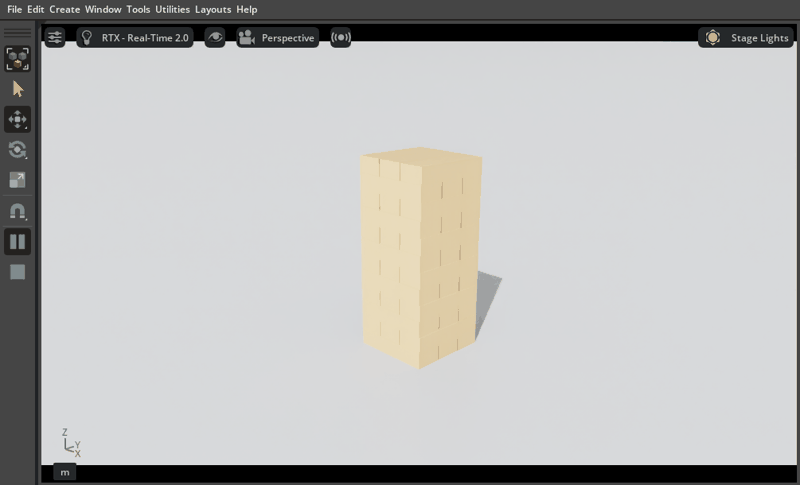
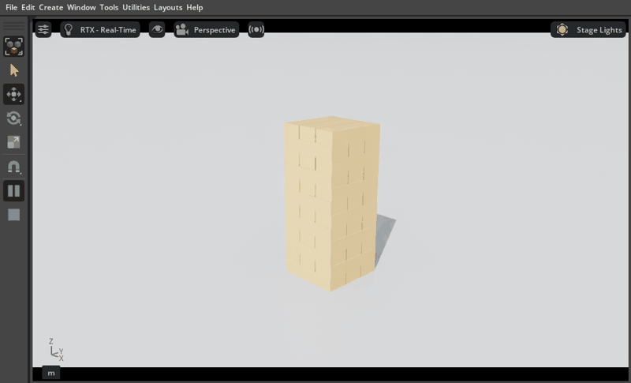

# `sim__prim__create_many`, windowed on Isaac Sim 6.2 and 5.1

Date: 2026-11-04. Code: the `feat/batch-build` branch at commit `3bf2273` (PR 74). One run per build, on a desktop with
an RTX 5080, PhysX, a real window (not headless), each in a throwaway Kit started for the check and stopped afterwards.

What was done, with no `run_python`: `sim__quick_start`, one `sim__material__create`, then **one** `sim__prim__create_many`
call that made a group Xform and 36 rigid blocks (mass 0.015 kg, a shared material from `defaults`). The viewport was framed
with `sim__viewport__frame`, then the timeline was played for 10 s and the top block read with `sim__body__state`.

| Build | create_many | After 10 s of play | Top block height (authored 0.1725 m) |
|---|---|---|---|
| Isaac Sim 6.2.0 | 37 prims made | tower standing | 0.1714 m |
| Isaac Sim 5.1.0 | 37 prims made | tower standing | 0.1714 m |

| 6.2.0, playing | 5.1.0, playing |
|---|---|
|  |  |

Before this tool the same tower took 43 create calls and 72 material calls.

Notes and limits:
- The crops show the viewport and toolbar of the real window; the pause button is lit, so the timeline was playing.
- One run on each build is an illustration, not a measurement of variation. The block heights match to the millimetre on both builds.
- On 6.2 the status bar briefly showed a bridge warning, `client ... could not be answered (Bad file descriptor)`. It is
  logged when a client connection closes while the bridge is answering; it did not affect any call in this run.
- Not covered here: Newton, other builds, and a weak-agent run choosing the tool unprompted.
