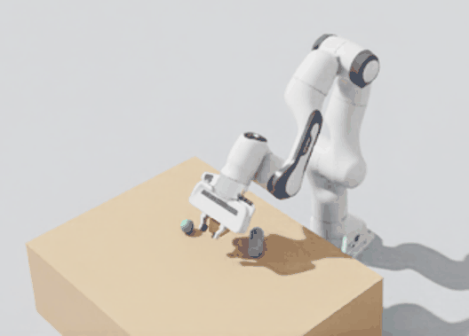
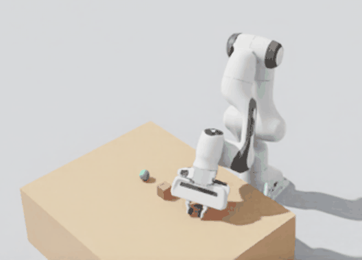

# Wishlist test: pick-and-place with a Franka arm (2026-11-04)

One tester agent was given a plain request and only the tools, in an isolated sandbox, and asked to keep notes and a wishlist
(the method in the `mcp-wishlist-testing` skill). This page records the exact prompt and model, what it reported, what I
checked myself, and what changed because of it.

## Who and what

| | |
|---|---|
| Tester model | Gemini 3.8 Flash, thinking level high (Antigravity) |
| Operator | Claude Sonnet 5.5 |
| Code under test | `main` at `8ab5147` (includes `sim__prim__create_many`) |
| Simulator | Isaac Sim 6.2.0, PhysX, headless, started for the sandbox only, with its own empty asset folder |
| Tool access | A small helper script that calls any tool by name through a throwaway host. Its default hid `run_python`, so the tester worked without it |

## The exact prompt

> I'm building a pick-and-place demo for a robotics project. Please get a robot arm into a simulated scene with a table and a few small objects, and have it pick one of them up and put it down somewhere else. If a real pick-and-place turns out not to be possible with these tools, get as far as you can and tell me exactly where it stops and why. Show me pictures along the way, and also see what happens when the arm bumps into one of the objects.
>
> You have a set of tools for this, reachable from the shell in your working directory:
>
> - `<home>/.local/share/uv/tools/isaac-mcp/bin/python <sandbox>/call.py --list` lists every tool.
> - `<home>/.local/share/uv/tools/isaac-mcp/bin/python <sandbox>/call.py <tool> '<json arguments>'` calls one tool.
> - Read the tool descriptions first. If they are not enough, documentation exists in <sandbox>/tree/docs.
>
> Work on your own. Do not ask me questions; make reasonable choices and say what you chose.
>
> # Rules (read carefully, these are real limits)
>
> - **Folders:** you may read and write only inside `<sandbox>` (and its subfolders). Everything else is off limits, including my home folder, config and data.
> - **Resources:** the graphics card has 16 GB and one Isaac Sim is already running on it, so do not start another simulator or any training job. Keep any single step short.
> - **No installs, no sudo.** Do not install packages or change the system.
> - **Do not run scripts or build tools that come from downloaded code.** Reading files is fine.
> - **Only trusted public sources** for anything you download (well-known robotics organisations on GitHub, or the robots the tools offer by name).
> - **Never touch my real data or config.** If a tool seems to point at something outside the sandbox, stop and write it in your notes.
>
> If a rule blocks what you want to do, do not work around it. Write it in your notes and carry on with something else.
>
> # Notes and wishlist (required)
>
> Keep a file `<sandbox>/notes.md` **as you go**, updated every few steps (do not wait until the end). It already has headings; fill them in:
>
> - what you tried and why;
> - what worked;
> - what failed, **with the exact error text copied verbatim**.
>
> At the end, finish with the section titled **Wishlist** that is already in the file: tools or options you wished existed, and for each one what you tried instead and roughly how many calls it cost. Be honest about what you could not do or are unsure about; "I could not do X" is a useful answer. Do not invent results.
>
> When you are done (or stuck), say so in `notes.md` under "Status" and stop.

`<home>` and `<sandbox>` replace the real folders; nothing else was changed.

## What the tester reported

It chose NVIDIA's Franka Panda by name, built a table and three small objects (a 4 cm cube, a cylinder and a sphere), and about
34 tool calls later reported a full pick-and-place: approach, grip, lift (cube height 0.270 m to 0.329 m), carry, place and
release, then two collisions: the arm toppled the cylinder, and a joint driven into the table stopped with `settled: false`.
It needed about 12 calls of trial and error to find joint angles, and no `run_python`.

| Lifted | Bumped |
|---|---|
|  |  |

The cube is small in these crops; the heights above come from the tester's body-state readings in its notes, not from the pictures.

## What I checked myself, and what I did not

Checked by reproducing it on a fresh Franka in a throwaway Isaac Sim:

- **Confirmed:** the Franka asset gives `panda_finger_joint1` a drive (stiffness 400, damping 80, max force 7.2) and
  `panda_finger_joint2` no authored drive at all. This is why the first grasp slipped.
- **Confirmed:** `sim__prim__find` had no `root` argument (its arguments were `contains`, `type_name` and `limit`).
- **Confirmed:** `run_python` was missing only because the helper's default hid the bridge built-ins. That is a sandbox
  setting, not a defect.

Not re-run by me: the pick-and-place sequence itself, its numbers, and the pictures' content. They are the tester's report,
which I read but did not reproduce.

## Triage

| Finding | Class | Action |
|---|---|---|
| A joint with no drive (a second gripper finger) silently ignores a position target | b, small fix | **Done:** `sim__joints__inspect` marks it `no_drive` and lists `joints_without_drive` with a hint to use `sim__joints__gains` |
| `sim__prim__find` could not be limited to a robot's subtree | b, small fix | **Done:** a `root` argument |
| No inverse kinematics or Cartesian end-effector move; about 12 calls of trial and error per reach | c, new tool | Ranked first below |
| No gripper command (open, close, grip with force) | c, new tool | Ranked second below |
| No tabletop preset in `sim__quick_start` | c, nice to have | Ranked last |
| Tools need `session_id` and `stage_id` even to read the stage | known design | Intentional: stops a call landing on the wrong stage. Left for Kaleb to decide whether read-only tools may omit them |
| `run_python` missing | e, sandbox setting | None |

## Ranked wishlist

1. **End-effector move / inverse kinematics** (`sim__arm__ik` or a move-to-pose tool): needed constantly, about 12 calls per
   task. Isaac Sim ships a kinematics solver; check which robots it covers before designing.
2. **Gripper command**: open, close and grip by width and force, syncing the fingers and reporting contact. Part of the
   problem (an undriven finger) is now flagged by the inspect fix.
3. **Tabletop preset**: one call for a table and a few pickable objects.
4. (From earlier runs, still open) force and impulse on a running scene, and smooth joint trajectories during play.

The ranked list is in section 3 of `docs/plans/CHECKLIST.md`.
