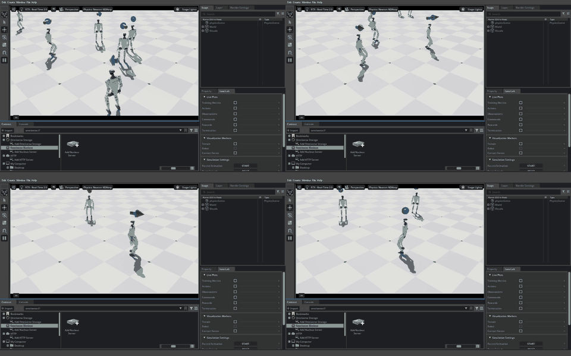

# PR 81 agent tests, 2026-11-05: a humanoid from GitHub, and a humanoid trained to walk

Two plain-request tests of the PR 81 branch, by a free model that only had the tools. Everything here was verified by the
operator against the files, logs and video, not taken from the tester's report. The checklist items are F9 to F13 in
[plans/CHECKLIST.md](../plans/CHECKLIST.md).

## Setup (both runs)
- **Tester:** OpenCode, `opencode/pulse-alpha-free` (a free model, kept on purpose), default effort (high). No tool calls were supplied by the operator: the tester chose them.
- **Tools:** a stdio helper that calls any tool by name, in a sandbox folder under the workspace's `projects/`, with its own asset store, approval file (no roots), Lab source copy and jobs folder. The tester was told not to use any other Isaac tools. Afterwards the real asset folder was unchanged (171 files, same checksum) and no real Isaac tool had been used.
- **Stack:** Isaac Sim 6.2.0.0, Isaac Lab 3.0.0 (the newest stable of each), RTX 5080 16 GB, headless training and a visible window for demos.
- **Server code:** run 1 on the PR 81 head `1ab6123`; run 2 on `012efc8` (the fixes found by run 1).
- **Human turns** (by the operator, as a user would): run 1, "run it with a visible window (not headless)" and "there is no time limit on runs". Run 2: none.

## Run 1: "get a humanoid from GitHub into a scene"
Prompt, word for word (paths shown as `<sandbox>`):

```text
Start by running: cd <sandbox>

# Your task

I want to try a humanoid robot in Isaac Sim. Find a well-known open-source humanoid robot on GitHub, download it, get it into a simulation scene, make it do something (even just standing there or moving a joint), and show me a picture and a short video of it.

You have a set of tools for this, reachable from the shell in your working folder:

- `./call.py --list` lists every tool.
- `./call.py --describe <tool>` shows one tool's full description and arguments.
- `./call.py <tool> '<json arguments>'` calls one tool.
- Read the tool descriptions first. If they are not enough, documentation exists in `<sandbox>/server-copy/docs/`.

Use only these tools for the simulator. Your shell may also offer other Isaac tools of its own: do not use those, they point at my real setup. Work on your own and do not ask me questions; make reasonable choices and say what you chose.

# Rules (read carefully, these are real limits)

- **Folders:** your working folder is `<sandbox>`. Read and write only inside it. Put anything you download in `<sandbox>/downloads/` and copy your final pictures and videos into `<sandbox>/out/`. The screenshot and recording tools save into `~/Pictures/screen-mcp` and `~/Videos/screen-mcp`: reading and copying from there is fine, writing anywhere else outside the working folder is not. Do not read `<sandbox>/private/`.
- **Resources:** the GPU is small (16 GB): one heavy job at a time, and keep any single run under 15 minutes.
- **No installs, no sudo.** Do not install packages or change the system.
- **Do not run scripts or build tools that come from downloaded code.** Reading files is fine.
- **Only trusted public sources** for anything you download: well-known GitHub organisations only.
- **Never touch my real data or config.**
- **Approval:** some files need my approval before the simulator may load them. You cannot approve anything and the tools cannot either. If a tool tells you approval is needed, copy the exact message into notes.md under "Needs my approval", then finish your turn with a short message saying what I have to run. I will run it and write back to you, and then you carry on.

If a rule blocks what you want to do, do not work around it. Write it in your notes and carry on with something else.

# Notes and wishlist (required)

Keep a file `notes.md` in your working folder as you go, updated every few steps (do not wait until the end). It already has the structure to use. Record what you tried and why, what worked, and what failed with the exact error text copied verbatim.

At the end, fill in the **Wishlist** section: tools or options you wished existed, and for each one what you tried instead. Be honest about what you could not do or are unsure about; "I could not do X" is a useful answer. Do not invent results. When you are done (or stuck), set "Status" in notes.md and stop.
```

**Outcome: worked, about 9 minutes, about 45 tool calls.** The tester chose Unitree H1 from `unitreerobotics/unitree_ros` (BSD-3-Clause; the tester called it "MIT-ish"), cloned it, copied the robot folder into the asset folder, built a pack with `assets__pack_build`, launched a windowed Sim, loaded the robot with `sim__quick_start`, moved the right arm and torso, took stills, and recorded a 21.8 s video (h264, 1440x900, 15 fps; the arm is visibly raised in frames at 5 s and 9 s, and the torso twists at 15 s).


- **No approval was asked for.** The asset folder is trusted, so copying files into it with a shell and building a pack needs none. Decision: keep approval for paths outside the folders, and record provenance (F9): `assets__pack_build` now takes `origin`, and the docs and skill say to use sources the user names.
- The URDF has a fixed base and position drives only: it stands in place and cannot walk.

## Run 2: "train a humanoid to walk"
Prompt, word for word:

```text
Start by running: cd <sandbox>

# Your task

I want to train a humanoid robot to walk in Isaac Sim, using the open-source tools that are already set up. When it can walk, show me a video of it walking. Go step by step and tell me what you chose and why.

You have a set of tools for this, reachable from the shell in your working folder:

- `./call.py --list` lists every tool.
- `./call.py --describe <tool>` shows one tool's full description and arguments.
- `./call.py <tool> '<json arguments>'` calls one tool.
- `./call.py --script steps.txt` runs many calls in one server session (read the top of `call.py`). Use it whenever one call has to still be alive for the next, for example a screen recording.
- Read the tool descriptions first. If they are not enough, documentation exists in `<sandbox>/server-copy/docs/`.

Use only these tools for the simulator and training. Your shell may also offer other Isaac tools of its own: do not use those, they point at my real setup. Work on your own and do not ask me questions; make reasonable choices and say what you chose.

# Rules (read carefully, these are real limits)

- **Folders:** your working folder is `<sandbox>`. Read and write only inside it. Copy your final pictures, videos and a short results summary into `<sandbox>/out-2/` (create it). The screenshot and recording tools save into `~/Pictures/screen-mcp` and `~/Videos/screen-mcp`: reading and copying from there is fine, writing anywhere else outside the working folder is not. Do not read `<sandbox>/private/`.
- **Resources:** the GPU is small (16 GB), so run one heavy thing at a time (a training job, or a simulator window, not both). There is no time limit on a run: let training take as long as it needs, and check on it from time to time.
- **Windows:** training can run without a window. Anything you want me to see, such as the final walking demo, should run in a visible window.
- **No installs, no sudo.** Do not install packages or change the system.
- **Downloads:** I have not named any source for you, so do not download anything. Use what the tools already provide. If you think you need something from the internet, say what and why in notes-2.md and carry on with what you have.
- **Do not run scripts or build tools that come from downloaded code.**
- **Never touch my real data or config.**
- **Approval:** if a tool tells you approval is needed, copy the exact message into notes-2.md under "Needs my approval", then finish your turn with a short message saying what I have to run. I will run it and write back, and then you carry on.

If a rule blocks what you want to do, do not work around it. Write it in your notes and carry on with something else.

# Notes and wishlist (required)

Keep a file `notes-2.md` in your working folder as you go, updated every few steps (do not wait until the end). It already has the structure to use. Record what you tried and why, what worked, and what failed with the exact error text copied verbatim. For training, write down which task, library and settings you picked, how long it ran, and the numbers that show whether the robot learned to walk (for example reward and episode length) and where you found them.

At the end, fill in the **Wishlist** section: tools or options you wished existed, and for each one what you tried instead. Be honest about what you could not do or are unsure about; "I could not do X" is a useful answer. Do not invent results. When you are done (or stuck), set "Status" in notes-2.md and stop.
```

**Outcome: worked, about 40 tool calls.** The tester chose Isaac Lab's `Isaac-Velocity-Flat-G1` (Unitree G1, flat ground, velocity tracking) with `rsl_rl`, 1024 environments, 1500 iterations, seed 1. Training took 479 s (about 8.6 minutes, exit 0). I re-read the TensorBoard file independently:

| Scalar | First | Last |
|---|---|---|
| `Train/mean_episode_length` (cap 1000) | 14.4 | 948 |
| `Train/mean_reward` | -1.07 | 9.34 |
| `Episode_Reward/track_lin_vel_xy_exp` | 0.002 | 0.777 |
| `Metrics/success_rate` | 0.125 | 0.674 (max 0.868) |
| `Episode_Termination/base_contact` (falls) | 0.000 | 0.067 |
| `Metrics/base_velocity/error_vel_xy` | 0.988 | 0.272 m/s |

`isaaclab__eval` on the final checkpoint, 16 episodes: mean return 27.25 (std 10.9, min -2.74, max 34.11), mean length 886 of 1000. One run and one seed, so not an average, and about 7% of episodes still end in a fall. The tester then ran the policy with `isaaclab__play` (6 robots, visible window) and recorded the window for 45 s (h264, 1440x900, 20 fps). The frames show several G1s walking on a checkered floor with the velocity-command arrows.



- **Physics engine: Newton MJWarp, not PhysX.** The task's own config selects it, the job log banner says `Physics newton_mjwarp`, and the play window title says so. Nothing in the tools reported this, so `isaaclab__runs_status` now returns `physics` and `environment_ready` (F12). Newton is experimental in Isaac Sim here; a PhysX run of the same task was not done.
- The tester could not aim the play window's camera: that Kit window does not run the MCP bridge.
- It recorded with one `call.py --script` session, because a screen recording ends when its MCP server process exits (the fix for run 1's lost recording).

## Wishlist and what was done with it
| Item | Verdict | Action |
|---|---|---|
| Run 1: one session for several calls (recording lifetime) | verified | helper `--script` mode; `start_screen_recording` says it ends with its server process |
| Run 1: named humanoids (`unitree_h1`, `unitree_g1`) | verified, asked for by Kaleb | added; also fixed the robot starting half in the floor |
| Run 1: settle option for `sim__camera__capture` | not proven | waits for more evidence |
| Run 1: video probe tool | tester error (the bundled ffmpeg works) | none |
| Run 2: readiness and engine in `isaaclab__runs_status` | partly the tester's: the setup line was in the log, pushed out of the last 20 lines, as the tool's own hint says | added `environment_ready` and `physics` |
| Run 2: camera for the play window | verified, new feature | open (F13) |
| Run 2: one-call video of a play run | `--video` needs `moviepy` and `imageio-ffmpeg` in the Lab env, which are not installed; the tool refuses with that message and points at window recording | open, decision for Kaleb |
| Run 2: per-episode eval breakdown | verified (`episodes` is only a count) | already on the checklist ("Eval beyond mean return") |
| Run 2: live training curves | **not a defect**: I tested `isaaclab__metrics_summary` and `isaaclab__tensorboard_tail` on a run still training (step 480) and both worked | none |

## Not tested
A walking policy trained from a URDF pulled from GitHub (needs a task and robot config built from a URDF: an open checklist gap); a PhysX run of the G1 task; other seeds or longer training; the approval command flow in an agent run (run 1 did not need it).
