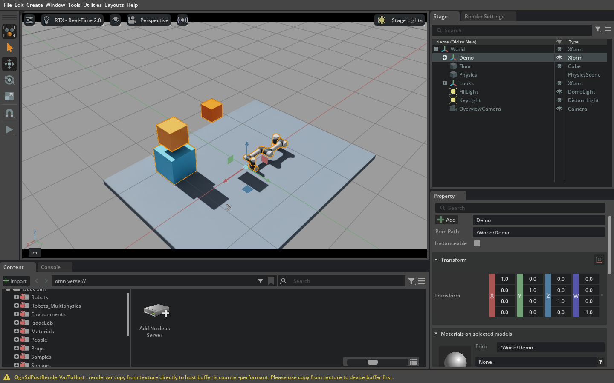
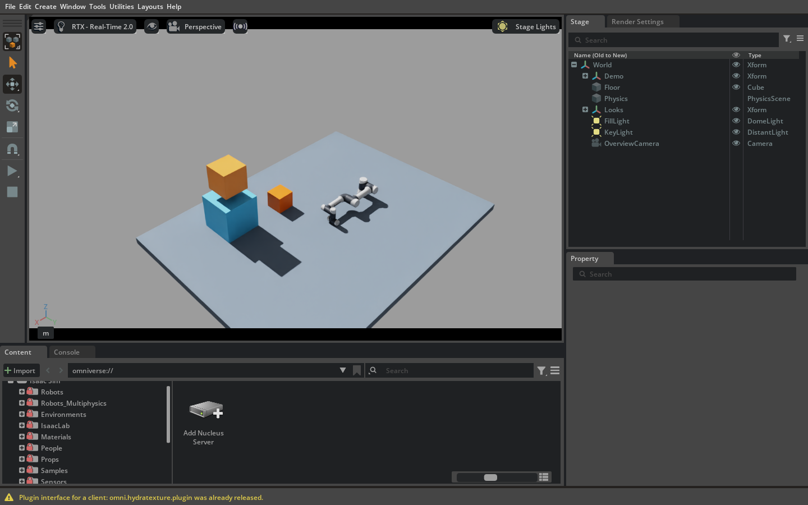

# Project assets and generic scene evidence

**Combined draft under validation, 2026-11-02.** PR #10 is merged. The owner subsequently
chose one combined review PR, [#16](https://github.com/kalebcoleman/isaac-mcp/pull/16),
containing #11–#15; all implementation PRs remain unmerged. PR #11 supplies six asset
and 31 generic scene tools; PR #15 adds two asset workflow tools, for 39 combined.
Isolated untrusted loading, authenticated remote upload, presets/manifests and the
remaining fork-parity work are deferred, not completed capabilities.

Start with the [current tool/source/backend reconciliation](CURRENT-TOOL-RECONCILIATION.md)
and its [99-row case index](CURRENT-TOOL-RECONCILIATION-20261102.json). Exact `fdb7a02`
real MCP discovery confirms 90 default / 99 optional-inclusive tools; eight
online/offline filter profiles retain their exact environment settings. The map
links 12,073 retained call records and 1,583 observation links from 39 source-identified
cases. These counts include expected errors and failed workflows, not 99 verified
tools on every backend. The later [exact `0163` normal PhysX supplement](PHYSX-CURRENT-POSITIVE.md)
adds 445 calls / 230 assertions across five builds in both modes, closing the narrow
body/joint/step gap without changing those historical counts. PhysX is the release
target; Newton remains experimental. The original `20f` PhysX stall remains open,
and the combined PR is still a draft.

The latest [affected PhysX qualification](RECENT-AFFECTED-PHYSX-2C8-20261102.json)
uses exact combined `2c8ce63` on all five installed builds, headless and windowed:
all 23 UR tools and seven built-ins, real ROS effects, existing PhysicsScene and
saved callback checks. [Final validation](FINAL-VALIDATION.md#integrated-affected-physx-paths-five-builds-both-modes)
separates fresh reopens from same-process checks, retains the initial edit-target
predicate failure, and records native writeback and visual limits. This is an
affected-path supplement, not a relabeling of historical 99-tool or agent evidence;
the original `20f` stall and remaining Newton checks are still open.

Subsequent [6.0.0.1 Newton qualification failed](RECENT-NEWTON-6001-FAILURES-20261102.json)
in both modes on exact `2c8ce63`. Generic scripted checks completed, but the twin
workflow lost Kit; a separate fresh control stalled during room loading. Private
pause/thread controls did not establish a remedy. The index preserves those
distinctions and six later real-MCP error-envelope checks on `826b84b`, which fix
host reporting only. [Failure details](FINAL-VALIDATION.md#newton-60001-failures-and-separate-host-error-reporting)
and the draft bundle exclude raw crash dumps and environment metadata.

The [6.0.1 Newton state/rendering supplement](RECENT-NEWTON-601-STATE-20261102.json)
retains the later `826b84b` NaN/black-image failure and private solver controls.
Fresh `ba1d4b2` passed 33 calls/14 checks of improved runtime-error and partial-step
reporting, then later rendering controls exposed body scale loss and ended in a
native Play/Pause segmentation fault. Error reporting is qualified; Newton
stability is not. [Details](FINAL-VALIDATION.md#newton-601-state-rendering-and-reporting-qualification)
separate the unexecuted Fabric correction, sampled visuals and exact sources.

The trusted workflow is exercised through real MCP with original multifile USD/URDF/USDZ
fixtures and a separately licensed real Agilebot robot. Root checks, snapshots, dependency
inspection, filters and managed launch are **not an OS sandbox**. Untrusted configuration
fails closed; no remote upload service or unrestricted fallback is advertised.

The [new-camera clipping matrix](RECENT-CAMERA-CLIPPING-1F21407-20261102.json)
qualifies exact `1f21407` on all five installed builds in both modes: 500 core MCP
calls, 40 cameras and 80 actual rendered outputs, with bounded pixel/units/error
checks and inspected application windows/Consoles. [Scope and warning counts](FINAL-VALIDATION.md#new-camera-clipping-five-builds-both-modes)
and [reproduction](CAMERA-CLIPPING-REPRODUCTION.md) retain the distinction from
physics, fresh Kit reopen, Newton failure remediation and broad all-tool coverage.

## Evidence map and scope

- [Current source/backend reconciliation](CURRENT-TOOL-RECONCILIATION.md),
  [current per-tool case index](CURRENT-TOOL-RECONCILIATION-20261102.json),
  [historical all-tool validation ledger](ALL-TOOLS-MATRIX.md), [original 99-name argument/evidence index](ALL-TOOLS-INDEX-20261102.json),
  [recent headless checks](RECENT-CHECKS-20261102.json),
  [6.0.1 windowed checks and unresolved stall](RECENT-601W-20261102.json),
  [6.1 both-mode, agent and saved-output checks](RECENT-61-20261102.json),
  [6.2 existing and isolated locked environment checks](RECENT-62-20261102.json),
  [6.2 locked-environment independent task](RECENT-62-AGENT-20261102.json),
  [current-runtime 6.0.0.0 modes, actual use and fresh reopen](RECENT-6000-20261102.json),
  [current-runtime 6.0.0.1 and three fresh agent-save reopens](RECENT-6001-20261102.json),
  [6.2 Newton twin candidate effects and failure history](RECENT-NEWTON-TWIN-62-20261102.json),
  [PhysX reopened-wrench failure and candidate correction](RECENT-PHYSX-WRENCH-62-20261102.json),
  [final validation work and failures](FINAL-VALIDATION.md).
- [Earlier per-tool behavior](TOOL-COVERAGE.md), [release/backend results](RUNS.md),
  [compact call inventories](RUN-SUMMARIES.json), [installed package records](INSTALLATIONS.json).
- [43-tool fork comparison](../../FORK-COMPARISON.md), [setup and schemas](../../TOOLS-SCENE.md),
  [compatibility](../../COMPATIBILITY.md), [plan and deferred gates](../../plans/ASSET-SCENE-END-TO-END.md).
- [SHA256SUMS](SHA256SUMS) verifies the small committed evidence files.
- Full redacted transcripts, native/CPU logs, failure history, session identities and copied
  reproduction scripts are in the **draft GitHub evidence release**.
  [Release asset URLs and SHA-256](RELEASE-ASSETS.md) identify each bundle. Draft assets require
  repository access; the owner can use `gh release download untagged-8a38d708b61458020a38`.

Paths use `<worktree>`, `<repo>`, `<home>`, `<sim-install-…>` and `<host>` placeholders. The
records remain observations of the actual runs, but their redacted bytes differ from originals.
`REDACTED-SHA256SUMS` inside each bundle verifies distributed bytes; source/image/response hashes
inside historical transcripts identify the original observations and must not be treated as
hashes of redacted JSON. Saved robot geometry, private native dumps and unreviewed images are
omitted, including inline base64 screenshot payloads in transcripts and copied diffs. Large recordings and snapshots stay outside Git. Selected images below are unchanged
application-window captures, each under 400 KB; no terminal or personal desktop content is kept.

The privacy guard runs with `scripts/check_docs.py`, including nested gzip/tar/zip payloads,
member names and metadata. Combined commit `5a4f710` removes six dead historical
exemptions: the old gripper path is absent and five FMB1 files remain with different,
clean bytes. The combined scan has no asset exemptions. This does not rewrite original
historical run identities. Screenshot pixels require separate visual inspection.

## Revisions and actual environment

Ubuntu 24.04.5, kernel 7.0.0-38-generic, RTX 5080 (16,303 MiB), NVIDIA 580.178.04, Python 3.12.3;
host MCP 1.30.0, minimum SDK 1.22.0, CPU OpenUSD 26.11. Actual Kit/extension/loaded library
identities accompany stage-info responses. Pip metadata alone can differ from loaded Warp.
Existing installations were reused read-only; these were separate disposable processes and
settings, not freshly rebuilt pristine installations. Kit writes ordinary logs/caches.

| Product code revision before privacy squash | What it establishes |
|---|---|
| `f32876520ebaee97ef56c5c4422f84fb833bd8f8` | Original copied-CPU attachment adapter; historical37-tool6.2 and agent proof. |
| `1135ec42c88c3dfedfad7966bc606f0e4d8ba39f` | Four-component build qualification, older LiDAR, scoped Newton adapters, trusted USDZ, async World initialization. |
| `9fe39d4fee7605733da54c127092cae3f20c75a6` | Reuse only verified identical snapshots; full PhysX tool/stress suites and independent tasks on older builds. |
| `faaf73d5eb7b135cd703fb56da1369f85d346e37` | Current-target refusal details, default-on scene opt-out, cold CPU readback priming and safe stage teardown; full 6.1 suite and independent agent. |
| `08cf0c9` | Reopenable exports omit native runtime render graphs; CPU preservation/refusal tests and live6.2 suite plus6.0.0 fresh-process reopening. |

Old commit identifiers are retained as historical run identities. The owner requested removal
of private paths from **reachable PR history**; the implementation branch is therefore squashed
onto the updated planning branch. Source-hash manifests and frozen source patches in the bundles
map earlier runs to their exact code. Final PR-head validation and product-tree identity are
reported in the PR body and final validation release record. History rewriting does not assert
that previously fetched copies or GitHub caches have been erased.

## Automated review validation

Exact combined `ece55d130020e56e2f7f7781e0df6335d816e159` passed **1,184 host tests**
and **216 minimum-SDK tests** (MCP 1.22.0), plus wheel/sdist, npm dry-run,
documentation/catalog, asset and privacy checks. The intentional duplicate-ZIP and
Pydantic lifespan warnings remain; the earlier bridge EBADF warning did not recur in
that run after its lifecycle fix. Later fixes have their own focused checks: combined
`230f4b3` passed 149 URDF/USD/advanced/gateway/catalog/asset tests and 16 workstation
tests. These are not a full CPU run of that later candidate. Detailed change-specific
records are in [final validation](FINAL-VALIDATION.md); CPU results do not replace
cross-version live behavior or independent-agent gates.

## Measured behavior and retained failures

The later 6.0.1 windowed run at `20f2953` passed its broad suite, then stalled in a
native synchronous physics step during independent use. It required force-stop of
the owned process. Successful fresh repeats and a new named-workflow task do not
resolve that failure. A separate legacy checkpoint physics-type defect and bridge
discovery defect were fixed and qualified narrowly at combined `6bc45c2`.
The [windowed supplement](RECENT-601W-20261102.json) preserves all distinct scopes;
the original stall remains an open material limitation.

The later exact `6bc45c2` 6.1 PhysX broad suites passed in both modes, with separate
legacy, light/clone and articulated URDF readbacks. Independent named-tool use passed
17 checks in 90 requests; a fresh `d725f84` headless process reopened its composed
save and passed 12 checks in 16 requests. [The 6.1 supplement](RECENT-61-20261102.json)
retains per-process warning counts, sampled visual scope, source preservation and
the camera's live-ownership limitation. It does not resolve the 6.0.1 stall or certify
the remaining version/backend matrix.

Earlier revisions called all 37 tools through real MCP on each of the five installed PhysX releases. Exact
cases and revision differences are in RUNS.md. Each release passed a 217-capture stress sequence
across three resolutions, timeline transitions and exact physics steps, with known LiDAR plane
geometry and coordinate transforms. Independent actual-use tasks on all five releases imported
both approved projects, measured fall/rest and joints, captured real images, saved output and
checked source/sibling preservation. These tests establish the stated workflows, not every
parameter, backend, lifetime or sensor synchronization case.

A stronger independent URDF readback subsequently found that native conversion success
could leave the physics variant unselected or invalid. The missing mass/body result,
source fix and fresh `230f4b3` 6.0.1 headless measured-joint qualification are recorded
in [final validation](FINAL-VALIDATION.md). Older call-success counts do not establish
URDF physics functionality on every build.

Failures are retained: session-layer physics/writeback divergence; old borrowed-GPU capture
CUDA700/native crashes; initial snapshot quota exhaustion;6.0.0 cold first-image latency;
6.0.1 native sensor-stage reset crash; too-short sensor warm-up; invalid serialized native
render handles; strict joint target tolerances and test-harness version/schema mistakes.
Retests are identified separately. A failed strict joint tolerance is not relabeled as success
because a command was accepted. An expected guard refusal is not working-capability evidence.

The earlier fresh-process 6.0.0.0 `NOT_READY` failure is retained in the historical records.
It was traced to serialized native Replicator orchestration with no corresponding Python
subscription in the new process. The export now omits recognized runtime orchestration, and
camera capture waits for a fresh public renderer CPU transfer. Historical candidate
`c75455d` also preserved authored ROS camera helpers while omitting their regenerable native
writers and temporary product links. A fresh 6.0.0.0 process reopened the ROS-camera workcell,
published real RGB/CameraInfo/TF, matched optical axes and monotonic clocks across Stop/Play,
captured a new generic camera image and saved again. The final five-release, all-exposed-tool
matrix remains in progress; earlier SHA results are not presented as final-head qualification.

The save fix exports a private composed copy, omitting only recognized native SyntheticData
pipelines and pack render products. User Action Graphs and sensor definitions remain, the live
stage stays unchanged, and unknown native-pipeline content refuses publication. A default camera capture waits for bounded fresh rendering/readback after reopening;
LiDAR still needs simulation/render warm-up. Exports retain texture dependencies and are
**not physics/controller checkpoints**.

UR5e's World constructor uses the extension async initialization path and restores the terminal
flag before awaiting. The review runs retain warnings instead of suppressing them.6.0.1's
fresh cleanup retest completed sensor stress and20/20 UR5e smoke after the earlier native crash.
The final 6.2 `./verify.sh`, smoke, motion and existing `/physicsScene` checks are recorded in
final validation. Only test-owned processes are stopped. Tests preserve the user checkout, other sessions and their source assets. Combined PR #14
separately changes the distributable asset/cache policy, with its own license and provenance audit.

Newton's qualified MuJoCo paths were separately tested on all five installations for two cycles
of actual fall/rest, joint movement, measured step timing and pose exports. Full37-tool and
independent-agent coverage on **every Newton backend/version is still missing**. The separate installed Lab 3 / Sim 6.2 workflow exercised all 12 Lab tools, including actual
training, metrics, video and playback; later mode fixes have exact-byte candidate evidence.
Neither that private video overlay nor the older Sim environments establish clean installation.
Physical hardware, other drivers/GPUs, future releases and exhaustive sensor lifetimes remain
unverified. CPU tests retain Lab/bridge/gateway/managed-session regressions.

## Actual application screenshots

Original6.2 independent task before and after automatic physical settling (PID1672242,
window46137357, historical adapter `f328765`; runtime checks are in its transcript):




Later independent tasks have selected-window captures on
[6.0.0.0](images/agent6000-rest.png), [6.0.0.1](images/agent6001-rest.png),
[6.0.1.0](images/agent601-rest.png), and [6.1.0.0](images/agent61-rest.png).
Their reports record window IDs/PIDs, tool results and original hashes. Images were inspected
for actual scene content and visible private paths. Screenshots prove visible output; separate
runtime state, velocity, joint and timing observations support physics conclusions.

## Research and provenance

The fork at `bfcd2111a9a98657ea87ba3be8564ea19c1a89e6` has **43 actual registrations**,
including 12 simulation tools. README, tool definitions/handlers, version adapters, tests,
examples, limitations and MIT license were inspected. Its CPU suite passed 349 tests with its
declared MCP<2 dependency; a separate MCP2 mismatch is retained. A disposable fork6.2/PhysX run
made 24 real MCP calls across 18 tools (fall/rest, robots, camera and LiDAR), not all 43. No paid
service was used. The other three requested pins were inspected, not run; remote default heads
still matched all four pins at research time. See comparison and bundle research records.

No upstream implementation code or robot geometry is copied. Original fixture generation is
in `scripts/make_scene_fixture.py` (CC0); package fixtures are also original CC0. The real robot
is [Agilebot GBT-C5A at33281110](https://github.com/sh-agilebot/agilebot_isaac_usd_assets/tree/33281110dd75017fcb821ef4a7316960c0702e18/gbt-c5a),
five USD layers and three textures, separately audited under BSD-3-Clause. The vendor license
and third-party statement were checked; [notice](../../provenance/agilebot-LICENSE) retained.
Workr candidates were not used on the strength of root MIT alone. Installed OmniPBR remains an
external trusted NVIDIA dependency. Source manifests in agent records verify unchanged inputs.
[MIT attribution](../../provenance/whats2000-LICENSE) and the separate
[omni-kit-mcp permission question](../../VENDORING.md) remain recorded.

Official NVIDIA camera migration/known-issue/asset-validation/ScriptNode documents and OpenUSD
dependency documentation were checked against installed APIs. ComputeAllDependencies and
opt-in ScriptNode behavior actually ran; NVIDIA's complete asset-validation suite did not.
Those mechanisms are not containment. No audit or hostile-USD security guarantee is claimed.

## Reproduction

Use a disposable simulator and explicit approved roots as in TOOLS-SCENE.md. Inventory bridges,
windows, GPU/RAM and target PID first. `scripts/validate_scene_tools.py`,
`validate_scene_equivalents.py`, `validate_scene_edges.py`, `validate_scene_sensors.py`,
`validate_scene_clear.py`, `validate_scene_sessions.py` and `validate_scene_reopen.py` are real
MCP test clients. Full copied run orchestrators are in the release, not the Git evidence tree.
Replace neutral path placeholders with your own approved locations; never target a user's stage.

```bash
python3 scripts/check_docs.py
python3 scripts/gen_host_catalog.py --check
# In mcp/, with test/isaaclab/scene-test dependencies:
pytest -q
uv build
# Explicit disposable port and one-time trusted-project config:
ISAAC_MCP_ASSET_CONFIG=/approved/config.json python scripts/validate_scene_tools.py --port 19063 --output /private/core.json
```

The release includes complete commands, selected ports/domains/PIDs, setup, schemas, calls,
responses, timestamps, pass/fail/refusal distinctions, cleanup records and source identities.
Isolated loading, authenticated remote transport and preset contracts remain this plan's work;
non-security parity follow-ups are assigned to PR #12. Configured Claude is authorized for
independent remote tests when that deferred workflow is resumed; no remote test success is claimed.


The [self-contained Lab follow-up](RECENT-LAB-20261102.json) records all 12 tools,
headless/windowed train/eval/play, decoded videos, actual Console/input review and
owned-process cleanup at `c2ceb7f`. Its draft supplement includes the exact setup
profile/lock and script manifest. Two upstream package conflicts, sampled-video
limits and the distinction from generic Newton are explicit in [final validation](FINAL-VALIDATION.md).


The [6.1 Newton contact follow-up](RECENT-NEWTON-61-CONTACTS-20261102.json)
records the production failure and unshipped collider controls, including a
fresh repeated-cycle assembly failure. See [final validation](FINAL-VALIDATION.md#newton-61-contact-failures-and-unshipped-collider-controls)
for the separate room timeout, visual limits and guarded cleanup; no solver fix
or broad Newton support is claimed.
