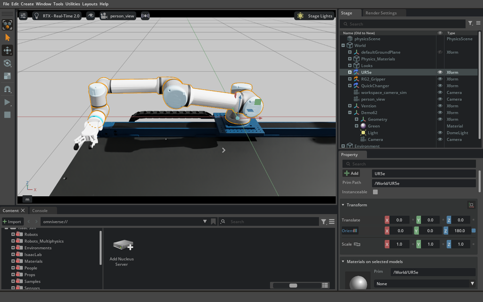
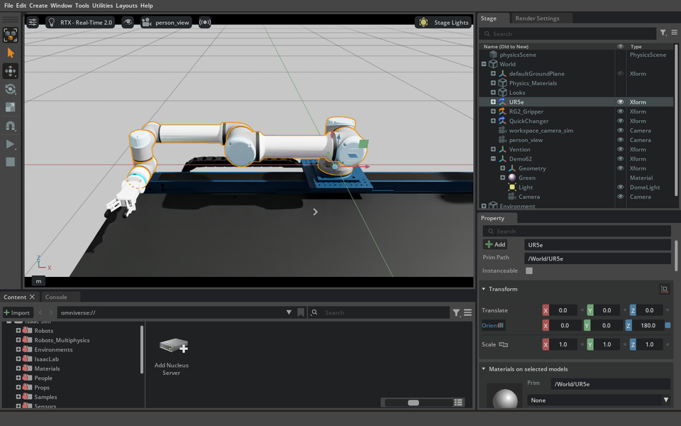

# Real simulation demo

These are original, unedited MCP window captures of an operator-approved workstation.
They show the full UR5e and attached Husarion RG2 during a commanded target-and-return
workflow. They are simulation observations, not physical robot demonstrations.

| Target | Return |
|---|---|
|  |  |

## Source and scope

- Source: `2fdf4044ffdaa081431c14485a88d00abe185c07`, Isaac Sim **6.2.0.0**,
  build `6.2.0-rc.14+release.52805.02189a84.gl`, Kit
  `110.4.0+feature.386251.187cf21b.gl`, windowed **PhysX**.
- Ubuntu 24.04.5, RTX 5080, driver 580.178.04, Python 3.12.3, X11.
  The existing installation had **NumPy 2.5.4**, conflicting with the kernel's **2.3.1** pin.
  The pictures retain that identity; they do not represent the later locked environment.
- The independent task recorded 119 requests (28 before a user-interaction hold, 91 after),
  15 passed numerical/artifact checks, and six seconds of measured simulation time.
  Its ledger has 38 scoped passes, two partial results and 59 uncalled tools.
- The user clarified that the intervening lighting/framing edits were theirs and authorized
  continuation. The resumed task used the same process. No product defect is inferred from that hold.
- Product files matched the source; the diagnostic launcher also enabled logging/faulthandler
  and opened a prior saved scene. No NVIDIA vendor source modification was used.
- These stills and the selected video samples were visually reviewed for content and privacy.
  The tool controlled arm motion; RG2 opening was not independently commanded in this task.

| File | Bytes | SHA-256 |
|---|---:|---|
| `ur5e-target.png` | 224476 | `185097328ec255c1e4c78e1128773bc67b4ffe0becb9da7c518a3a9e83fe9f4c` |
| `ur5e-return.png` | 258430 | `20a2991c3a67e057616e21067ca0b5fe0f63f1822e035037b19ce25ca589f949` |

## Video access and publication

The genuine `window-ur.mp4` recording is **42.9 seconds**, 960×600, 168758 bytes,
SHA-256 `1f35d635ba5fed2520ff20e88368b41a6bf494074c0463fb973193a818bb7f55`.
All 429 frames decoded; visual review sampled frames **0, 150 and 428**, not every frame.
It shows the full robot and gripper during target and return.

It is currently inside **`agent62w-2fdf-evidence-v2.tar.gz`** in the unpublished draft evidence
release (3129287 bytes, SHA-256
`fb864cfa1d5aceaa61aed501494bf626bc58c758f5e2cd66fa9417e3296a360e`).
A [standalone MP4 attachment](https://github.com/kalebcoleman/isaac-mcp/releases/download/untagged-8a38d708b61458020a38/agent-62w-2fdf-full-ur-video.mp4)
now exists in the same **unpublished draft**; its remote size and SHA-256 matched the original.
It is not publicly accessible, so the README does not link to it. The README thumbnail therefore opens this page, where access
requirements are explicit, rather than promising a public player. Authorized repository reviewers can obtain the bundle:

```bash
gh release download untagged-8a38d708b61458020a38 --repo kalebcoleman/isaac-mcp \
  --pattern agent62w-2fdf-evidence-v2.tar.gz
sha256sum agent62w-2fdf-evidence-v2.tar.gz
```

Draft access requires repository permissions. See the [evidence release index](../evidence/project-scene/RELEASE-ASSETS.md).
Before public video publication, the maintainer must confirm permissions and the final
privacy review, upload the approved original recording as a release asset, verify its bytes
and SHA-256, then replace the README thumbnail destination with the actual public asset URL.
Do not publish the draft release merely to make a README link work.

## Asset notices

The captures show licensed, operator-approved NVIDIA/Vention workstation assets and the
Husarion gripper. They do not include USD, URDF, textures or composed geometry. Selection
of these captures for the user's demo request is **not a new license grant** or permission
to redistribute the underlying assets. See [vendoring](../VENDORING.md) and
[per-asset provenance](../provenance/ASSETS.md). The wider task used the BSD-3-Clause
Agilebot fixture ([notice](../provenance/agilebot-LICENSE)) and an original CC0 test fixture;
those facts do not change the workstation's separate terms.

The small SVG badges in `badges/` are repository-authored navigation labels, not external
certification marks or live test results. They load without a third-party badge service.

## README example captures

`franka-public-robot.png`, `block-tower.png`, `nova-carter-room.png` and `so100-own-pack.png` are headless
camera captures made with `sim__camera__capture`, then reduced to 128 colors for size. They show Isaac Sim **6.2.0.0**
with **PhysX**, from the repository state at the time the README was written, on an RTX 5080.

- The Franka Panda and Nova Carter are NVIDIA's public Isaac Sim assets, loaded by name from NVIDIA's asset server.
- The block tower and the room are boxes made by the tools; the tower image is after six seconds of play.
- The SO-ARM100 is the Apache-2.0 [TheRobotStudio/SO-ARM100](https://github.com/TheRobotStudio/SO-ARM100) URDF, loaded
  from a pack in a throwaway asset folder.
- These are single runs shown to illustrate the tools, not a test result.

## Humanoid captures in the README

`g1-github-scene.png`, `g1-walk-300it.gif` and `g1-walk-1500it.gif` come from live runs on 2026-11-04 (RTX 5080, PhysX).

- `g1-github-scene.png`: a headless camera capture on Isaac Sim 6.2.0 of the Unitree G1 from `unitreerobotics/unitree_ros`
  (BSD-3-Clause), built into a pack and imported as a fixed-base URDF. Reduced to 128 colors.
- `g1-walk-300it.gif` and `g1-walk-1500it.gif`: six to seven seconds each, cut from 40-second window recordings of
  `isaaclab__play` on Isaac Lab 2.3.2 with Isaac Sim 5.1.0, task `Isaac-Velocity-Flat-G1-v0`, checkpoints after 300 and
  1,500 iterations, 6 environments. Cropped to the viewport, 8 fps, 40 to 48 colors. The full recordings are not in git.
- Short run: 1,024 environments, seed 1, 152 s; evaluation 16 episodes, all 1,000 steps, mean return 13.3 (range 7.4 to 21.6).
  Longer run: seed 2, 727 s; mean return 34.4 (range 32.5 to 35.6). One run each, not a measurement of variation.
