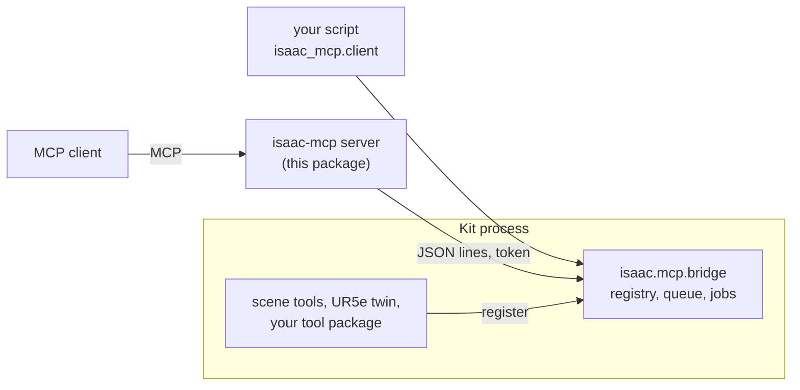

# isaac-mcp

Host-side Model Context Protocol (MCP) server for Isaac Sim, Isaac Lab and Omniverse Kit, with one CLI, `isaac-mcp`.
It connects MCP clients to the tools inside a running Kit process and adds desktop capture and Isaac Lab job control.
This page covers the host package and adding your own tools. For the project overview and setup, see the
[project README](../README.md).

## Install

Install it as an editable tool, shared by every MCP client. The simulator and desktop tools are Linux x86_64 only.

```bash
# From the repository root. This links ~/.local/bin/isaac-mcp.
./install.sh --no-sim
# The same host environment, without client registration or the ffmpeg shim:
uv sync --project mcp --locked --extra isaaclab --no-dev
```

Both use `mcp/uv.lock`. `uv tool install` does not read that lock, so it is not a reproducible checkout install.
`uv sync --locked` checks the lock's hashes and installs the `isaaclab` extra (TensorBoard). The installer also creates an `~/.local/bin/ffmpeg` shim for the Kit viewport recorder when
that path does not already hold an unrelated file; the sync command alone does not. For the pinned Sim
installation and EULA requirements, see [Linux setup](../docs/LINUX-SETUP.md). For where things live, see
[Workspace](../docs/WORKSPACE.md).

To register a client, run `./install.sh --no-sim --claude` from the repository root for Claude Code and Claude Desktop,
or see [client configuration](../docs/MCP-SERVER.md#4-client-configuration) for the others.

## Tools

The host lists its tools from startup, even before a simulator is running. Those that act on a scene execute through
a bridge, and return an error with connection guidance when none is available. See
[Tool arguments](../docs/TOOLS-ARGUMENTS.md) for all of them.

| Group | Reference |
|---|---|
| `refresh_tools`, `use_bridge`, screenshots, recording, window placement, `join_videos` | [Host tools](../docs/TOOLS-HOST.md) |
| `status`, `run_python`, `job_status`, `job_cancel`, `reload_tools`, file tools (bridge built-ins) | [Bridge built-ins](../docs/TOOLS-HOST.md#kit-bridge-built-ins) |
| `sim__*`, `assets__*` | [Scene tools](../docs/TOOLS-SCENE.md) |
| `ur5e_dt__*` | [UR5e tools](../docs/TOOLS-UR5E.md) |
| `isaaclab__*`, `run_script` | [Isaac Lab and script-job tools](../docs/TOOLS-ISAACLAB.md) |
| `window_*`, `sim__launch` and friends (opt-in) | [Optional desktop input and sessions](../docs/TOOLS-HOST.md#optional-desktop-input) |

Set `UR5E_DT_PORT` to pin a bridge (`ISAAC_MCP_PORT` is the generic fallback). With several running and no pin, discovery
refuses rather than guessing. See [Environment variables](../docs/ENVIRONMENT.md).

For a clean viewport render without desktop chrome, use `ur5e_dt__start_recording` and `ur5e_dt__stop_recording`. A screen
tool call with `window` or `window_id` reads that window's own pixels, so overlapping windows do not appear in the capture.
`screenshot()` and `start_screen_recording()` with no target pick the Isaac Sim window when it is open. Window recordings
keep the window's native size, capped at 1920 wide (`max_width`); pass `full_screen=True` to letterbox into the monitor's
shape, or `window_ids=[...]` to record several windows into one video. Monitor captures show the desktop as displayed.

## How it reaches a simulator

Inside Kit, the `isaac.mcp.bridge` extension keeps a registry of tools and listens on one local
port per Kit process. Tool packs register under a namespace, so two projects can each have a
`play_scene` (`arm.play_scene`, `rover.play_scene`). This server is a client of that socket; so
is any script using `isaac_mcp.client`.



The bridge requires a token, which clients on the same account find by themselves, and can be
started read-only. The protocol, the scheduling rules and both switches are in
[docs/protocol.md](docs/protocol.md).

## What a client is shown

The default profile lists 30 tools; `all` lists 47: related single-purpose tools are offered as one tool with an `action` argument
(`sim__prim` with `action="create"`, `"get"`, `"delete"`, ...). `action="help"` returns the full
description of each action. Every single-purpose name (`sim__prim__create`) still works when
called, so older prompts and scripts keep running; those names are deprecated and are no longer
listed. Disabled toolsets register neither grouped tools nor their member tools. The groups are
defined in `isaac_mcp/tool_groups.py`.

## Loading the bridge in another Kit app

`./run.sh` enables the bridge by itself. For another Kit app, or a plain Isaac Sim install:

```bash
python3 scripts/install.py            # --dry-run to preview, --remove to undo
```

This edits the app's `user.config.json`, as the Extensions window's autoload checkbox does: it
adds `exts/` to the search path, enables `isaac.mcp.bridge`, and stores the
port (8766). Close the app first; with several Kit apps installed, name one with `--config`.

Then register the server with your client (Claude Code, Cursor and others read `.mcp.json`):

```json
{ "mcpServers": { "isaac": { "command": "isaac-mcp" } } }
```

With one simulator running no port is needed. Pin one with `"env": {"ISAAC_MCP_PORT": "8766"}`
when several run.

## Your own tools

A tool package is an ordinary Python package that the bridge imports:

```python
# my_tools/__init__.py
MCP_NAMESPACE = "robot_demo"

def register(registrar):
    @registrar.tool("Spawn a robot into the scene.", {"name": {"type": "string"}})
    def spawn_robot(name: str = "robot_1"):
        import omni.usd                    # Kit imports go inside the function
        ...
        return {"path": f"/World/{name}"}
```

```bash
python3 scripts/install.py add-project --path <folder holding my_tools> --module my_tools
# or, for one launch: ISAAC_MCP_TOOL_PATHS=<folder> ISAAC_MCP_TOOL_MODULES=my_tools
```

Clients then have `robot_demo__spawn_robot`, and scripts can call
`robot_demo.spawn_robot`. Copy `mcp/templates/demo_tools/` to start, and see
[docs/tool-authoring.md](docs/tool-authoring.md) for arguments, errors, reloading without a
restart, and the flags that mark a tool read-only or exclusive.

## Scripts, without MCP

```python
from isaac_mcp.client import BridgeClient, BridgeError, call

call("status")                                       # one call
with BridgeClient(port=8766) as bridge:              # many calls on one connection
    bridge.call("run_python", {"code": "result = 1"})
```

```bash
python3 mcp/isaac_mcp/client.py --list-bridges
python3 mcp/isaac_mcp/client.py <tool> ['{"json": "arguments"}'] [--port N]
```

`client.py` uses only the standard library and can be copied on its own. Exit codes: 0 success,
1 the bridge answered with an error, 2 unreachable or bad usage.

## More

- [docs/protocol.md](docs/protocol.md): messages, finding a bridge, the token, scheduling, read-only mode, jobs, several simulators, access from another machine.
- [docs/tool-authoring.md](docs/tool-authoring.md): writing, reloading and narrowing tools.
- [Environment variables](../docs/ENVIRONMENT.md): every setting. [The bridge inside an Isaac Lab script](../docs/TOOLS-ISAACLAB.md#the-bridge-inside-an-isaac-lab-script).

## Layout

```
mcp/isaac_mcp/            the MCP server, the bridge client, Isaac Lab jobs, screen tools
mcp/templates/            a tool package to copy, a remote driver, an Isaac Lab launch script
mcp/tests/                host tests; the bridge is tested here too, outside Kit
mcp/docs/                 the bridge: protocol, writing tools
exts/isaac.mcp.bridge/    the bridge extension
exts/sim-tools/           generic scene and asset tools
exts/ur5e-dt/             the UR5e digital twin
scripts/install.py        load the bridge in a Kit app on every launch
```

## Development

```bash
cd mcp
uv run --locked --isolated --python 3.12 --extra test --extra isaaclab --extra scene-test pytest -q
```
