# isaac-mcp

Host-side Model Context Protocol (MCP) server for Isaac Sim, Isaac Lab and Omniverse Kit, with one CLI, `isaac-mcp`.
It connects MCP clients to the tools inside a running Kit process and adds desktop capture and Isaac Lab job control.
This page covers the host package and adding your own tools. For the project overview and setup, see the
[project README](../README.md).

## Install

Install it as an editable tool, shared by every MCP client. The simulator and desktop tools are Linux x86_64 only.

```bash
# From the repository root. This links ~/.local/bin/isaac-mcp.
./install.sh --no-sim
# The same host environment, without client registration or the ffmpeg shim:
uv sync --project mcp --locked --extra isaaclab --no-dev
```

Both use `mcp/uv.lock`. `uv tool install` does not read that lock, so it is not a reproducible checkout install.
`uv sync --locked` checks the lock's hashes and installs the `isaaclab` extra (TensorBoard). The installer also creates an `~/.local/bin/ffmpeg` shim for the Kit viewport recorder when
that path does not already hold an unrelated file; the sync command alone does not. For the pinned Sim
installation and EULA requirements, see [Linux setup](../docs/LINUX-SETUP.md). For where things live, see
[Workspace](../docs/WORKSPACE.md).

To register a client, run `./install.sh --no-sim --claude` from the repository root for Claude Code and Claude Desktop,
or see [client configuration](../docs/MCP-SERVER.md#4-client-configuration) for the others.

## Tools

The host lists its tools from startup, even before a simulator is running. Those that act on a scene execute through
a bridge, and return an error with connection guidance when none is available. See
[Tool arguments](../docs/TOOLS-ARGUMENTS.md) for all of them.

| Group | Reference |
|---|---|
| `refresh_tools`, `use_bridge`, screenshots, recording, window placement, `join_videos` | [Host tools](../docs/TOOLS-HOST.md) |
| `status`, `run_python`, `list_bridges`, `reload_tools`, file tools (bridge built-ins) | [Bridge built-ins](../docs/TOOLS-HOST.md#kit-bridge-built-ins) |
| `sim__*`, `assets__*` | [Scene tools](../docs/TOOLS-SCENE.md) |
| `ur5e_dt__*` | [UR5e tools](../docs/TOOLS-UR5E.md) |
| `isaaclab__*` | [Isaac Lab tools](../docs/TOOLS-ISAACLAB.md) |
| `window_*`, `sim__launch` and friends (opt-in) | [Optional desktop input and sessions](../docs/TOOLS-HOST.md#optional-desktop-input) |

Set `UR5E_DT_PORT` to pin a bridge (`ISAAC_MCP_PORT` is the generic fallback). With several running and no pin, discovery
refuses rather than guessing. See [Environment variables](../docs/ENVIRONMENT.md).

For a clean viewport render without desktop chrome, use `ur5e_dt__start_recording` and `ur5e_dt__stop_recording`. A screen
tool call with `window` or `window_id` reads that window's own pixels, so overlapping windows do not appear in the capture.
`screenshot()` and `start_screen_recording()` with no target pick the Isaac Sim window when it is open. Window recordings
keep the window's native size, capped at 1920 wide (`max_width`); pass `full_screen=True` to letterbox into the monitor's
shape, or `window_ids=[...]` to record several windows into one video. Monitor captures show the desktop as displayed.

## The bridge

**One bridge, one port, per Kit process.** Projects register tools under a
namespace; name collisions between projects are impossible by construction
(two projects can each ship a `play_scene` — they land as `arm.play_scene`
and `rover.play_scene`), so co-loaded projects share the single socket.

```mermaid
flowchart TB
    subgraph kit["Kit process (Isaac Sim · Isaac Lab · any Kit app)"]
        direction BT
        BRIDGE["<b>isaac.mcp.bridge</b><br/>NDJSON TCP :8766 · owner/namespace registry<br/>main-thread dispatch<br/>builtins: run_python · list_tools · reload_tools · list_bridges · put_file · get_file · stat_file · status"]
        ARM["arm_tools/<br/>MCP_NAMESPACE = 'arm'"] -->|register| BRIDGE
        ROVER["rover_tools/<br/>MCP_NAMESPACE = 'rover'"] -->|register| BRIDGE
        PANEL["isaac.mcp.panel<br/>registry-driven UI"] -->|"dispatch (click == agent call)"| BRIDGE
    end
    GW["isaac-mcp gateway<br/>operator view: all tools + run_python"] -->|MCP ⇄ NDJSON| BRIDGE
    GWF["isaac-mcp gateway (filtered)<br/>ISAAC_MCP_NAMESPACE=arm · ISAAC_MCP_BUILTINS=0"] -->|MCP ⇄ NDJSON| BRIDGE
    CLI["isaac_mcp.client<br/>scripts · tests · doctors · CLI"] -->|NDJSON| BRIDGE
```



## Register the bridge in your own Kit app (once per machine)

`./run.sh` already enables the bridge. Use this for another Kit app or a plain Isaac Sim install.

Register the bridge permanently (afterwards, launches need no flags or env
vars):

```bash
# From the repository root:
python3 scripts/install.py            # add --dry-run to preview
```

This edits the Kit app's persistent `user.config.json` (the scriptable
equivalent of the Extensions window's AUTOLOAD checkbox): adds `exts/` as a
search path, auto-enables `isaac.mcp.bridge` + `isaac.mcp.panel`, and sets the
bridge port (default **8766**). Restart the app; the bridge binds with the
built-in tools. `--remove` undoes it.

With more than one Kit config on the machine it refuses to guess and lists them; pass the one you mean with
`--config <path/to/user.config.json>`. Run it while the app is **down**; a running app overwrites the file on exit
([why](docs/configuration.md#register-while-the-app-is-down)).

Connect an agent or IDE: install the host as above and add it to `.mcp.json` (Claude Code, Cursor, etc.):

```json
{
  "mcpServers": {
    "isaac": { "command": "isaac-mcp" }
  }
}
```

No port needed — the gateway discovers a lone running bridge. Pin one with
`"env": { "ISAAC_MCP_PORT": "8766" }` when several Kit processes run.

That alone is fully usable: `run_python` executes arbitrary Python on Kit's
main thread (persistent sessions supported; saved session vars auto-clear when
a new stage opens — they hold prim/handle references the new stage kills),
which reaches everything in the sim. Tools discovered from the bridge appear as native MCP tools
(`robot_demo.spawn_robot` → `robot_demo__spawn_robot`; dots are illegal in MCP names).

## Adding a project (the contract)

A project is a **plain Python package** — not a Kit extension. It declares a
namespace and either exposes one entrypoint (copy `mcp/templates/demo_tools/`) or
none at all ([declared toolsets](docs/tool-authoring.md#declared-toolsets)):

```python
# <workspace>/projects/myproj/isaac/myproj_tools/__init__.py
MCP_NAMESPACE = "robot_demo"                       # defaults to the module name
DOORWAY_ADMISSION = 1                              # the admission contract, docs/protocol.md

def register(registrar):                   # receives an owner-bound registrar
    @registrar.tool("Spawn a robot into the scene.", {"name": {"type": "string"}})
    def spawn_robot(name: str = "robot_1"):
        import omni.usd                    # Kit imports live inside handlers
        ...
        return {"path": f"/World/{name}"}  # payload only — no envelope
```

Register it persistently (once per project):

```bash
python3 scripts/install.py add-project --path <workspace>/projects/myproj/isaac --module myproj_tools
```

Next launch, the bridge advertises `robot_demo.spawn_robot`; the panel grows a `robot_demo`
section; agents see it after `refresh_tools`. Per-launch override instead of
persistence: `ISAAC_MCP_TOOL_PATHS=<workspace>/projects/myproj/isaac ISAAC_MCP_TOOL_MODULES=myproj_tools`.

> **One registration, three surfaces.** A registered tool isn't just an agent
> verb: the control panel renders it as a clickable widget automatically, and
> the reference client/CLI can call it from scripts — all three go through the
> same dispatch entrance. Write the tool once; button, agent call, and script
> call come with it.

A package with no `register()` is introspected instead: every public function
becomes a tool, its schema derived from the signature. See
[docs/tool-authoring.md](docs/tool-authoring.md) for declared toolsets, the handler
contract and curated per-project agent views.

## Scripting the bridge (no MCP needed)

The bridge's wire protocol is not MCP — the gateway above is the only MCP
speaker. For scripts, tests, and health checks, use the **reference client**
(stdlib-only, single-file, also copyable as-is):

```python
from isaac_mcp.client import call, BridgeClient, BridgeError
call("demo.ping", {"message": "hi"})                 # one-shot; endpoint auto-discovered
with BridgeClient() as c:                            # persistent + reconnect
    c.call("run_python", {"code": "result = 1"})     # (pass host=/port= to pin)
```

```bash
# From the repository root, with any Python (stdlib only):
python3 mcp/isaac_mcp/client.py <tool> ['{"json":"params"}'] [--port N]
python3 mcp/isaac_mcp/client.py --list-bridges      # what's running
# Or `python -m isaac_mcp.client ...` from an environment with the package installed.
# exit codes: 0 success · 1 bridge answered with an error · 2 unreachable or bad usage
```

With exactly one bridge running you need no port: the client discovers it
([endpoint resolution](docs/protocol.md#endpoint-resolution)).
`import isaac_mcp.client` works without the `mcp` SDK installed — only the
gateway needs it.

## What else it does

- **Hot reload** — edit a tool package and reload it without restarting Kit. [docs/tool-authoring.md](docs/tool-authoring.md#hot-reload)
- **Remote files** — ship code and assets to a remote box through the bridge. [docs/tool-authoring.md](docs/tool-authoring.md#remote-files-put_file--get_file--stat_file)
- **Control panel** — every registered tool becomes a clickable widget. [docs/tool-authoring.md](docs/tool-authoring.md#control-panel)
- **Request admission and doorway hold** — one queue with typed refusals, and a way to reserve the bridge for one caller. [docs/protocol.md](docs/protocol.md)
- **Multiple instances and remote access** — one port per Kit process, discovery, binding beyond localhost. [docs/configuration.md](docs/configuration.md)
- **Isaac Lab** — the bridge inside standalone train/play scripts. [docs/isaac-lab.md](docs/isaac-lab.md)
- **Tool-author gotchas** — Kit facts that cost real debugging time. [docs/tool-authoring.md](docs/tool-authoring.md#tool-author-gotchas-kit-facts-that-cost-real-debugging-time)

## Layout

```
mcp/isaac_mcp/               the MCP front-end (FastMCP server, TCP client to the bridge)
mcp/templates/demo_tools/     the template tool package; copy it to onboard a project
mcp/tests/                   host, protocol, registry and live-socket tests (no Kit needed)
mcp/docs/                    protocol, configuration, tool authoring, Isaac Lab
exts/isaac.mcp.bridge/       the bridge extension (protocol, bridge, builtins, autoload)
exts/isaac.mcp.panel/        registry-driven control panel (optional)
exts/sim-tools/              generic scene and asset tools
exts/ur5e-dt/                the UR5e digital twin tools
scripts/install.py           permanent registration: base install + add-project
```

## Development

```bash
cd mcp
uv run --locked --isolated --python 3.12 --extra test --extra isaaclab --extra scene-test pytest -q
```
